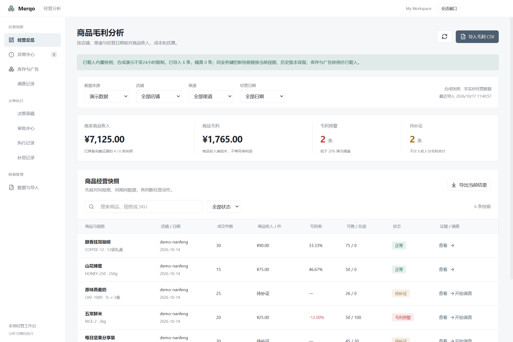
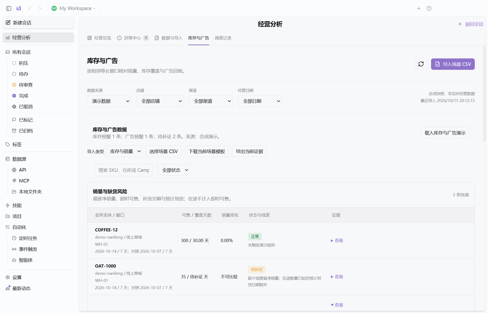
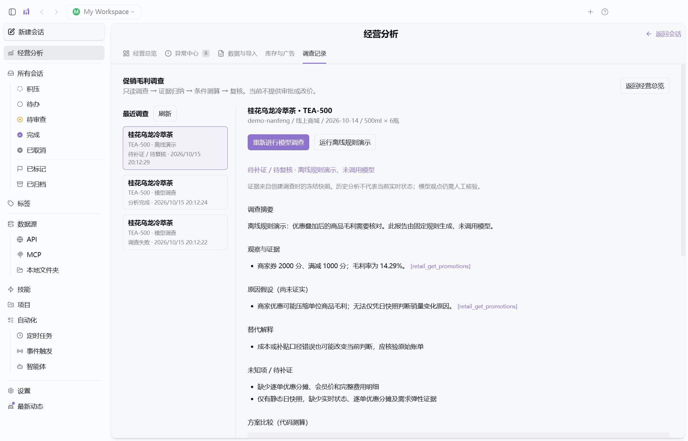
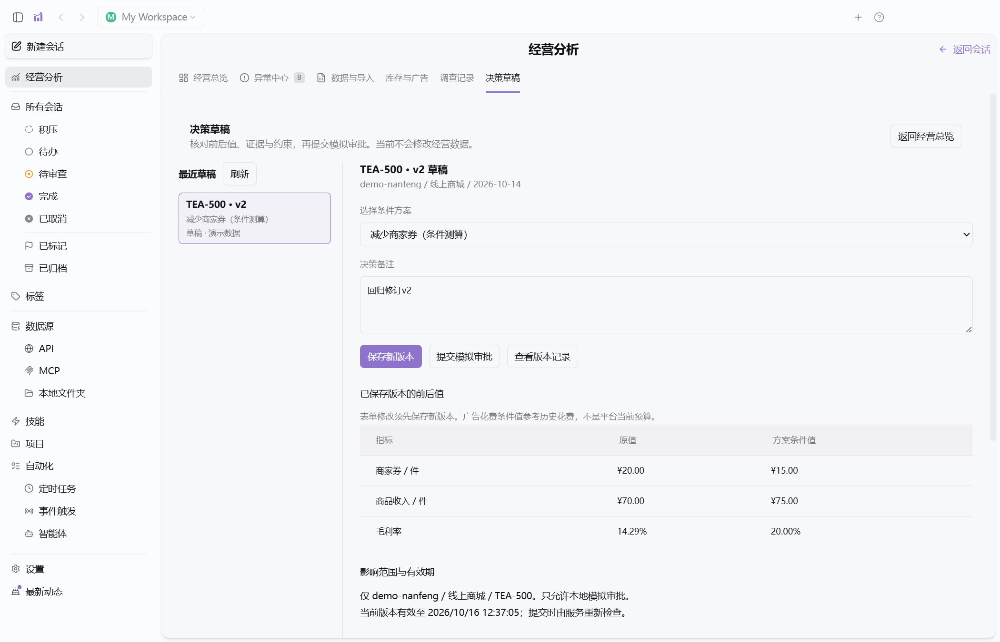
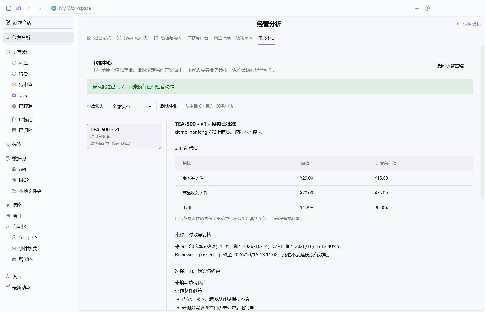
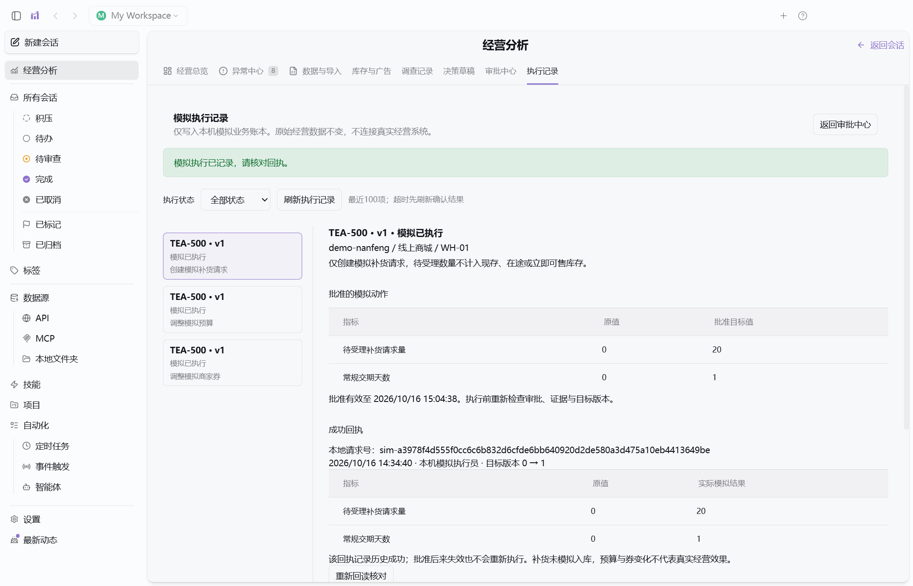
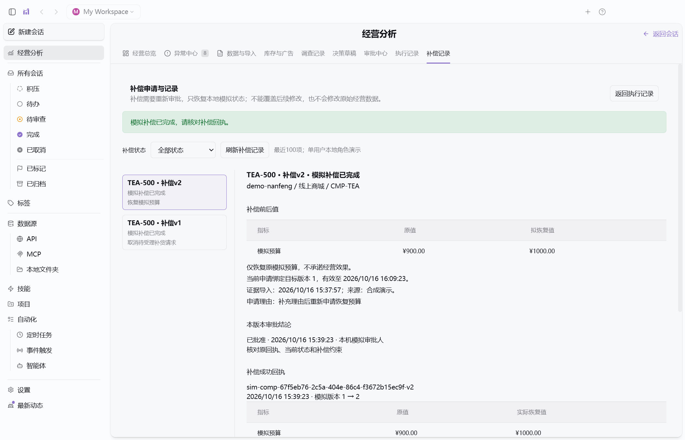
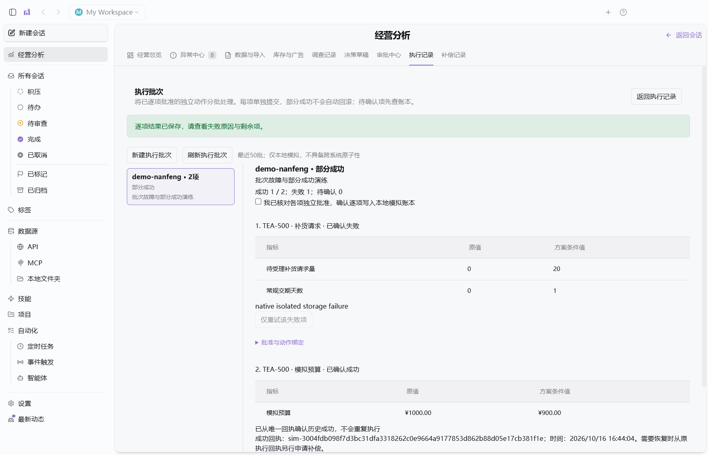
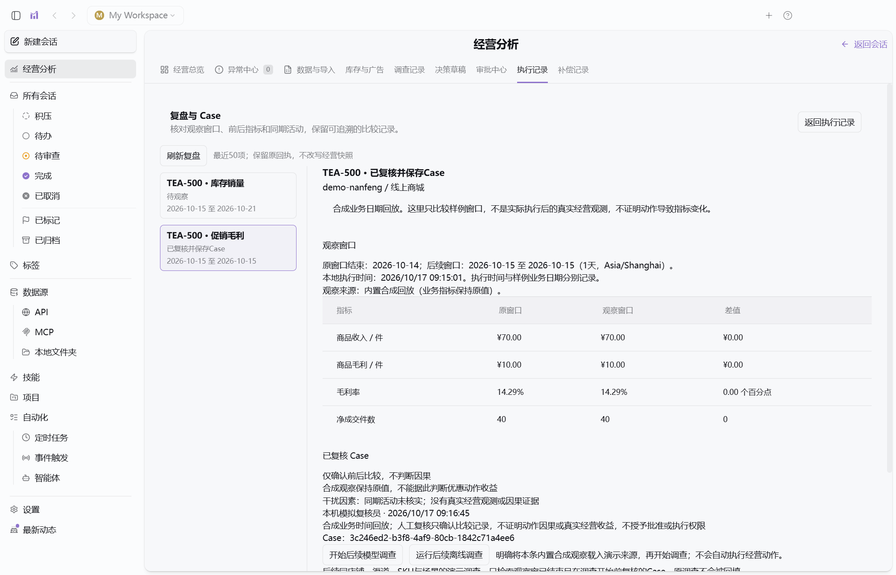

# Merqo

**An AI-powered desktop workspace for retail analytics, risk detection, and evidence-backed operational investigations.**

Merqo brings promotion margins, stockout risks, and advertising ROAS into one desktop workspace. Business metrics and anomaly rules are calculated by deterministic code; a bounded, read-only investigation workflow adds evidence-linked explanations and scenario comparisons for all three scenarios. Reports can be exported with their evidence, and selected plans become versioned local decision drafts.

Built on the Craft Agents desktop codebase using **Electron, React, TypeScript, Bun, and SQLite**.

> Windows desktop preview. Some launch scripts, runtime settings and historical screenshots retain the **RetailPilot** name. Sample results are synthetic and do not represent real business performance. The installer is an unsigned prerelease; full PRD release gates remain unmet.



## Features

| Scenario | Available today |
| --- | --- |
| Promotion margins | Merchant discounts and subsidy treatment, unit revenue and gross profit, margin alerts, missing-evidence checks |
| Sales and stockout risk | Adjacent-window sales comparisons, available inventory, coverage days, lead-time buffer and expected inbound arrival checks |
| Advertising performance | Comparable-window ROAS, relative changes, click conversion rates and attribution consistency checks |
| Decision drafts | Deterministic before/after values, immutable revisions, action/evidence hashes, expiration checks, simulation approval/rejection, isolated execution receipts and persistent audit history |
| Data and evidence | CSV mapping and preview, validation, quarantined rows, duplicate protection, versioned rules, source hashes and quality reports |
| Three-scenario investigations | Read-only tool loop, cited observations and hypotheses, alternative explanations, two deterministic scenarios, sequential Reviewer and persistent history |
| Scheduled checks | Persistent local rule scans, bounded manual catch-up, finding deduplication and interrupted-job recovery while the app is running |
| Business evaluation | 48 registered contracts, 48 executable cases passing, 0 unsupported cases explicitly excluded from passes; inspectable datasets, evidence and confusion matrices |

All three analytical scenarios work with synthetic data or imported CSVs **without model credentials**. All three investigations support a configured API model or an explicitly labeled offline rules demonstration.

### Data handling

- Synthetic and user-imported data remain separate.
- Missing values remain unknown; they are never silently converted to zero.
- Inbound stock does not count as immediately available inventory.
- ROAS comparisons require adjacent, equal-length periods and matching attribution windows.
- Corrections replace the current snapshot while preserving imported row history and batches.
- Each workspace has isolated SQLite databases. Investigation records retain the selected evidence snapshot across restarts.



## Download the desktop app

The beta.2 preview includes the completed Windows 11 acceptance described in [local acceptance](docs/M5-local-acceptance.md). Full PRD release gates remain incomplete.

**[Download Merqo for Windows x64 — 0.1.0-beta.2](https://github.com/RXQ6/Merqo/releases/download/v0.1.0-beta.2/Merqo-Setup-0.1.0-beta.2-x64.exe)**

[Release notes](https://github.com/RXQ6/Merqo/releases/tag/v0.1.0-beta.2) · [SHA-256 checksums](https://github.com/RXQ6/Merqo/releases/download/v0.1.0-beta.2/SHA256SUMS.txt) · [Installation and data locations](docs/windows-preview.md)

Run the installer, launch Merqo and select **经营分析 → 数据与导入 → 载入演示数据**. Retail analysis includes its own Bun runtime, data worker, MCP and Skills; you do not need Node.js or Bun. If Git Bash is absent, select **仅使用经营分析** on first launch. Git for Windows is still needed for the general Agent's shell tools. Configure your own model connection only when requesting a model investigation.

This Windows x64 preview was tested on Windows 11. It is not code-signed, so Windows may show an unknown-publisher or SmartScreen prompt. Check the source and SHA-256 before running it. Updates are downloaded manually from Releases. Uninstall retains user data; the development `.runtime` profile is not automatically migrated.

The beta.2 installer passed beta.1-to-beta.2 upgrade, first-run retail access without Git Bash, three-scenario MCP/protocol checks, pause/restart/resume, simulated execution, server pagination, normal restart, same-version reinstall and uninstall checks. These used a local model protocol fixture. See the [beta.2 verification record](docs/verification/windows-beta2-2026-10-18/report.json) for results and limits.

## Build from source

Source changes after beta.2 add verified inventory numerical facts, exact rational rounding for target stock, repaired CI checks and pagination metadata invalidation. These changes are documented in [the inventory/CI contract](docs/M5-inventory-numeric-contract.md); the beta.2 download above retains its original build. The v4 live-model batch passed margin 5/5, inventory 4/5 and advertising 5/5, with zero observed forbidden-action events; the inventory needs-evidence run is retained. This is a narrow synthetic gate, not production accuracy.

### Prerequisites

- Windows; development validation was performed on Windows 11. Other desktop platforms have not been validated for this fork.
- Bun and Node.js. Development validation used Bun 1.4.2, Node.js 24 and Electron 39.2.7.
- Git for Windows / Git Bash for inherited Agent functionality.
- Network access for the initial dependency installation.

```powershell
git clone https://github.com/RXQ6/Merqo.git
cd Merqo
bun install --frozen-lockfile
bun run retail:build
bun run retail:start
```

The initial build compiles the desktop application and supporting processes. Subsequent launches can use `bun run retail:start` directly.

If the Electron binary download fails, an optional mirror can be configured before retrying:

```powershell
$env:ELECTRON_MIRROR = 'https://npmmirror.com/mirrors/electron/'
node node_modules/electron/install.js
```

### Explore the demo

The current application UI is primarily Chinese:

1. If prompted for a model connection, choose **稍后设置** (Set up later).
2. Select **经营分析** (Retail analysis) in the desktop sidebar to switch to analysis within the same window. Select **返回会话** to return to conversations.
3. Open **数据与导入**, then select **载入演示数据** to load all three scenarios.
4. Open **库存与广告** to inspect inventory and advertising evidence.
5. Open **异常中心** to review the combined anomaly list.

Expected demo results:

| Check | Expected value |
| --- | --- |
| Eligible product revenue / gross profit | CNY 7,125.00 / CNY 1,765.00 |
| TEA-500 promotion margin | 14.29% |
| TEA-500 immediately available stock / coverage | 40 units / 2 days |
| CMP-TEA current / baseline ROAS | 1.80 / 3.00, a 40% decline |
| Combined anomalies, including evidence gaps | 8: four margin, two inventory, two advertising |

The sample 20% thresholds and two-day inventory buffer are **versioned demonstration rules**, not universal operating targets. Product gross profit excludes advertising, shipping and platform commissions.

## Analysis in the current window

Retail analysis switches inside the current desktop window. Click **经营分析** to enter the grouped analysis surface, then **返回会话** to return to the conversation workspace. Switching preserves the conversation shell and analysis page/filter state without opening another window. A normal quit restores the selected surface; former dedicated analysis windows are folded into the primary workspace window on upgrade. Model credentials are required only when requesting a model investigation, not for opening local analysis.

See [window design and acceptance](docs/retail-window-design.md).

## Scheduled retail checks

Open **经营分析 → 经营巡检** to enable minute-aligned checks of locally imported margin, inventory and advertising data. Choose demo or CSV data and a 15-minute, hourly or daily interval. The first check runs on the next minute tick for the current interval; repeated entries reuse the same config-version/slot record. Scheduling runs while the desktop app is alive, independently of the analysis page.

Manual checks work while paused. Catch-up covers the most recent 24 intervals, up to six per request, reading the snapshots available at catch-up time rather than reconstructing historical live data. Failures/interrupted jobs support up to three attempts with retained history. Config, results, business-content finding deduplication and lease recovery persist locally. No model calls, approvals or business executions are created by these checks. See [design and acceptance](docs/P0-scheduled-checks-design.md).

## Margin evidence and review

New margin investigations include a six-item evidence checklist separating snapshot arithmetic, causal evidence and real execution prerequisites. Missing-cost and scope conflicts remain blocked. The checklist states which evidence the current snapshot import can accept and which adapters remain unavailable. Reviewer sees the final disclosed unknowns before the report is saved; historical reports are not backfilled.

A fixed ten-case Reviewer evaluation is available with `bun scripts/merqo-margin-review-eval.ts --live` (up to twenty configured-provider calls). It is a Reviewer-only diagnostic, not the PRD's full business benchmark. See [implementation and acceptance](docs/M4-margin-evidence-design.md) for actual evaluation results and limits.

## Investigations

Select **开始调查** next to a margin, inventory or advertising alert, such as TEA-500.

The investigation workflow queries four scoped, read-only tools, separates observations from hypotheses, links claims to evidence, compares two scenarios and runs a sequential Reviewer. Calculations, evidence-reference checks, missing-data blocks and persistence are controlled by code.

Promotion-margin reports now obtain their numeric observations from code-verified frozen evidence. The model supplies qualitative explanations; **数值与引用核验** separates unit amounts, snapshot totals and coupon reductions. Arithmetic, unit or citation conflicts reject the report before Reviewer. This verifies consistency, not business completeness or causality; existing reports are not backfilled. See [numeric audit and validation](docs/M4-margin-numeric-design.md).

- Supported inference protocols: Anthropic Messages and OpenAI Chat Completions compatible endpoints.
- Supported authentication: API key, bearer token, or no authentication for a configured local compatible endpoint.
- Select the connection as the workspace or global default in Settings.
- Subscription OAuth, cloud identity and Responses-only connections are not supported by this investigation adapter yet.
- Model failures produce a visible failure state. They never automatically become offline results.
- **运行离线规则演示** explicitly runs a fixed-rule demonstration and labels the report accordingly.

Runs are limited to five minutes, twelve model decisions and one Reviewer round (at most two requests including a format correction), with at most two active investigations per workspace. Intermediate evidence and reports persist. Interrupted runs become retryable failures after their original deadline; automatic model resumption is not implemented.



## Decision drafts

From a completed investigation, select **生成决策草稿**. Choose one of its computed plans, add a note and save. The **决策草稿** tab shows before/after values, scope, evidence, constraints, version history and submission blockers. Parameter values come from domain code; the browser cannot submit arbitrary prices or quantities.

**提交模拟审批** creates a pending request bound to the exact version, action hash, evidence and expiry. It does not approve or execute anything. Changes create a new version and supersede the previous request. Only unchanged synthetic/demo evidence with a model Reviewer pass and feasible constraints can enter this local simulation inbox. Offline reports, evidence gaps, replaced snapshots, expired drafts and imported CSV business data are blocked. The local actor is explicitly a single-user demonstration identity. Built-in synthetic evidence does not expire after 24 hours. Its true import timestamps remain unchanged on identical reloads; changed samples can be explicitly restored as new evidence revisions. Drafts still expire after 30 minutes, and model Reviewer, version, scope and constraint checks remain required. Older policy drafts must be saved as a new version before submission.

If a draft is blocked, **关联调查与复核** shows its exact source mode and Reviewer notes. Select **查看原调查与补证** to open that frozen investigation without invoking a model. Correct missing evidence through **更新或补充证据**, then explicitly retry the model investigation and generate a draft from the new report. Old drafts and approvals are never silently rebound. Offline, needs-evidence and rejected reports remain blocked. See [recovery and live validation](docs/M4-reviewer-recovery-verification.md).

Export **Markdown** or **报告与证据 JSON** from an investigation, including failed runs with partial evidence. Files include the run ID, source, evidence index, frozen snapshot, trace, report and up to 30 associated decision revisions. See [acceptance steps](docs/M2-close-acceptance.md).



## Simulation approvals

Open **审批中心** or select **查看审批** on a submitted draft. Review the exact version, before/after values and evidence, then enter a reason to approve or reject. Revisions supersede older requests; expiry or changed evidence invalidates them without erasing the original conclusion. Processing rechecks all gates in a transaction, and conclusions persist across restarts. This is a single-user local role demonstration; approval does not execute an action. See [approval acceptance](docs/M3-approval-acceptance.md).



## Local simulated execution

After approval, select **查看模拟执行** or open **执行记录**. Review the exact version and values, confirm the local simulation scope, then execute. This changes a separate simulation ledger: merchant coupons, a simulated budget seeded from historical spend, or a pending replenishment request. It does not modify source snapshots or real platforms, receive stock, or claim improved revenue/ROAS.

Approval and a ready execution item persist together. Execution rechecks approval, evidence, expiry and the target version, uses a stable unique key, commits the local effect and receipt atomically, and rereads the result. Retries return an existing success rather than apply it twice. Timeouts require a ledger refresh before retry; state conflicts invalidate old approvals. Later evidence can proceed only when its starting values match the current simulated target. Receipts and reconciliation survive restarts and are included in report exports.

For inventory, the original five-day lead-time example correctly fails its pre-arrival-gap constraint. **载入补货执行演示** explicitly loads a one-day synthetic variant so the replenishment request workflow can be tested. See [execution acceptance](docs/M3-execution-acceptance.md).



## Compensation with renewed approval

Select **申请补偿** on a successful simulation receipt, or open **补偿记录**. The server derives the restore target from the original receipt and checks current evidence and the complete target version. A fresh reason and approval are required; revisions supersede older approvals. Only a locally pending replenishment request can be cancelled, without changing sellable stock.

Restoration must still pass current business constraints. The default margin example cannot restore its original coupon because that would violate the margin floor. A later target change blocks compensation even if values return to the same numbers; revisions cannot bypass that conflict. Successful compensation has its own unique receipt, reread checks, attempts and version history, all retained across restart and included in report exports. See [compensation acceptance](docs/M3-compensation-acceptance.md).



## Execution batches and uncertain outcomes

Open **执行记录 → 执行批次** to group 2–10 independently approved simulation actions in the same workspace, shop and channel. Each item retains its own approval, version and action hash. Successes remain committed when another independent item fails; **仅重试该失败项** retries only that item after rechecking its approval and evidence.

A persisted execution intent and expiring lease make interruptions visible as **结果待确认**. Continue and retry are blocked until **查询确认结果** checks the local atomic ledger and fences the old worker. Recovery confirms a matching receipt, a recorded failure, or local non-execution; it does not execute an action. Unverifiable outcomes stay blocked. This proof applies only to the local simulation ledger, not external platforms. Successful actions still require separately approved compensation to restore them.

See [batch acceptance](docs/M3-batches-acceptance.md) and [design](docs/M3-batches-design.md). This groups existing independent approvals; model-generated multi-action proposals and umbrella approvals are not implemented.



## Outcome reviews and Case history

From a successful receipt, select **创建或查看复盘**, or open **执行记录 → 复盘与 Case**. Reviews bind the original investigation, approval and receipt to an adjacent equal-length observation window. Built-in replay and previewed single-row CSV observations retain their provenance and immutable revisions. Open windows remain pending; missing values remain unknown. Reviewers record their conclusion and confounding factors before saving a read-only Case.

This is **synthetic business-date replay**, not measured business performance after the wall-clock execution time. Built-in observations preserve business metrics; they do not invent uplift. A simulated replenishment request does not become stock received. Cases confirm comparisons or explicitly record insufficient evidence; they do not establish causality or grant execution authority.

A reviewed built-in replay can explicitly seed a later demo investigation from its observation. The investigation freezes up to five matching Cases by workspace, shop, channel, SKU, scenario, dimensions and time. History is returned through the existing read-only `retail_get_sku_context` MCP tool and checked against the frozen run. Old investigations are not backfilled, and real CSV analysis does not retrieve synthetic Cases. See [review acceptance](docs/M4-review-acceptance.md) and [design](docs/M4-review-design.md).



## Business-contract source updates

The current source supports explicit flat bundle component mappings, pack-cost reconciliation, missing/conflicting evidence blocks, frozen investigation evidence and composition-scoped outcome reviews/Cases. Download the example from **数据与导入 → 下载组合装示例**. Free gifts per sales unit now add explicitly separate gift costs to margin and coupon simulations. Download their example from **数据与导入 → 下载赠品示例**; see [gift contract and acceptance](docs/M5-gift-contract.md). Explicit membership snapshots now select an eligible member price, enforce date validity and discount exclusivity, and bind cohort context through reviews. Download **数据与导入 → 下载会员价示例**; see [member-price contract](docs/M5-membership-contract.md). Public-offer snapshots now filter exact scope/date and availability, exclude unavailable low prices, block unknown stock and retain a separate reference price. Download **数据与导入 → 下载可售报价示例**; see [offer contract](docs/M5-offer-contract.md). Existing CSVs remain compatible. The `0.1.0-beta.2` installer includes this update; beta.1 predates it. See [local acceptance and package evidence](docs/M5-local-acceptance.md). See [bundle contract and acceptance](docs/M5-bundle-contract.md).

## CSV examples

Download templates in the application or use [fixtures/retail](fixtures/retail):

| Files | Purpose |
| --- | --- |
| `demo-operations.csv` | Promotion margin snapshots |
| `inventory-demo.csv`, `ads-demo.csv` | Stock and advertising demo data |
| `inventory-errors.csv`, `ads-errors.csv` | One accepted row and two quarantined rows each |
| `inventory-corrected.csv`, `ads-corrected.csv` | Replace the current snapshot and retain history |

CSV imports use UTF-8 and support a BOM and column mapping. Margin imports allow up to 32 MB and 100,000 rows; inventory and advertising retain the 2 MB / 10,000-row limit. Margin tables use server pages of 30 rows by default, with exact full-scope metric totals and current-page exports. Advertising money uses integer CNY minor units. Empty numeric cells represent unknown values. See the data contracts before importing operational reports.

## Architecture

```text
React desktop UI
    │ typed, allowlisted IPC
Electron main process
    ├── Trusted workspace scope and bounded worker requests
    ├── Inference adapter → configured API / local endpoint
    └── Bun data worker
          ├── Deterministic margin, inventory and ROAS rules
          └── Per-workspace SQLite snapshots, history and investigations
```

The retail investigation loop exposes scoped read-only data tools. It does not expose shell commands, arbitrary file access, arbitrary SQL or business execution. The inherited general Agent workspace is a separate capability surface and does not constitute retail business authorization.

The desktop investigation now calls the dedicated MCP server over stdio and loads its Skill resource. Every tool result is checked against the frozen investigation scope, including evidence hash, date, SKU, warehouse or campaign.

Standalone MCP: `bun scripts/merqo-retail-mcp.ts --workspace <absolute-workspace> --scenario margin|inventory|ads --record <id>`. Each process freezes one existing record, exposes four strict read-only tools and serves its versioned Skill. Desktop launches use `--run <investigation-id>` so later imports cannot replace the original evidence. Legacy investigation history remains labeled with its original transport. See [setup and acceptance](docs/M2-investigation.md).

Key paths:

```text
apps/electron/src/renderer/retail/   Retail pages and investigation views
apps/electron/src/main/retail*.ts   Workspace-scoped IPC and inference adapter
packages/retail-domain/src/         Data contracts, calculations, stores and Agent core
scripts/retailpilot-*.ts            Local launch and data worker entry points
fixtures/retail/                    Reproducible CSV examples
docs/                              Design, acceptance and verification records
```

The launcher stores local state under `.runtime/config` and `.runtime/chromium`; these folders are ignored by Git. It does not migrate existing Craft credentials. Configure model credentials through the application's Settings; the inherited `.env.example` is not required for the three analytical demos.

## Verification

Run after building:

```powershell
bun run retail:check
bun run retail:eval
bun run retail:check:mcp
bun run typecheck:all
bun test apps/electron/src/transport/__tests__/channel-map-parity.test.ts
node scripts/retailpilot-m1-e2e.cjs
```

The latest source verification on 2026-10-18 passed **211 tests and 1,578 assertions**, including the fixed business evaluation, plus domain and Electron TypeScript checks, a desktop build, three-scenario MCP regression and the bundle/gift/member-price/offer native UI workflows with process restart. Desktop tests use isolated profiles and write local reports under `artifacts/`.

### Fixed business evaluation

`bun run retail:eval` creates `dataset.json`, `report.json` and `report.md` in `artifacts/business-eval/`. The catalog registers the PRD's 12 failure modes with three variants each, plus 12 approval/execution faults. Each contract includes input, rule, allowed conclusions, required evidence, forbidden actions and expected state.

| Latest fixed-set result | Count |
| --- | ---: |
| Executable cases passed | 48 |
| Executable cases failed | 0 |
| Registered but unsupported cases | 0 |

All 48 fixed synthetic contracts now execute, including the three public-offer cases. Availability, exact SKU/specification, scope and business date are checked before choosing a reference price; unknown states block certainty. Reference quotes never overwrite transaction revenue. Member pricing remains limited to a single cohort/day; gifts to explicitly additional fixed free-gift costs; bundles to flat component cost reconciliation. Real customer authentication, live inventory verification, mixed-cohort sales, order-level allocation and nested bundles remain outside these implementations. The approval/execution harness uses a local model/Reviewer protocol fixture, which does not measure real-model reasoning quality.

For release checks, run `bun run retail:eval --release-gate`. It currently **exits 1** because release gates remain unmet. A normal evaluation exit of 0 only means there were no executable-case failures. See the [archived report](docs/verification/business-eval-offers-2026-10-18/report.md), [input contracts](docs/verification/business-eval-offers-2026-10-18/dataset.json), [full evidence](docs/verification/business-eval-offers-2026-10-18/report.json) and [scope and acceptance](docs/M5-business-evaluation.md).

Inference transport tests use a **local HTTP contract fixture**. They verify the adapter and tool loop, not real-model reasoning quality. Live DeepSeek V4 Flash smoke checks generated cited reports for three synthetic scenarios over actual MCP transport. Reviewer outcomes include passed and needs_evidence; neither outcome authorizes business execution. These are small engineering checks, not a full business-quality benchmark. Earlier checks completed inventory and advertising simulation chains. The latest single synthetic margin workflow also completed model review, simulation approval/execution, reread and Case creation after purpose-scoped disclosures were formed before review. The separate ten-case Reviewer diagnostic scored 5/10 before that disclosure repair; it remains recorded and has not been replaced by the successful workflow run. See [margin evidence validation](docs/M4-margin-evidence-design.md). See the [latest recovery and live validation](docs/M4-reviewer-recovery-verification.md) and [earlier evaluation record](docs/M2-verification.md).

## Status and roadmap

- **M5 evaluation foundation:** `bun run retail:eval` writes the fixed-case dataset and inspectable Markdown/JSON reports under `artifacts/business-eval/`. Current source result: all 48 registered cases execute and pass, with no unsupported cases. This finite synthetic set does not establish complete business coverage. `bun run retail:eval --release-gate` currently exits 1. See [business evaluation scope and acceptance](docs/M5-business-evaluation.md).
- **Available:** three analytical workflows, three scoped investigation workflows, conditional plans, Reviewer, persistent evidence, integrated read-only MCP, versioned Skills, Markdown/JSON export, versioned decision drafts and simulation approval/rejection with persistent invalidation and audit, plus three local simulation actions, unique receipts, reread reconciliation and separately approved single-action compensation, independent execution batches, durable uncertain outcomes and per-item recovery/retry, plus synthetic outcome reviews and scoped frozen Case retrieval.
- **Current PRD stage:** M5 evaluation foundation. M0–M4 provide the local three-scenario analysis and simulation workflow; business coverage gaps below remain open. M5 is not complete and release gates have not passed.
- **Windows preview:** a per-user x64 NSIS installer bundles the required retail runtime. Packaging and isolated lifecycle acceptance are documented separately from business-quality gates; beta.1-to-beta.2 upgrade passed on the current Windows 11 host; clean-VM and other Windows-version compatibility remain unverified. The unsigned beta.2 installer is available from the public download above and locally under `artifacts/windows/0.1.0-beta.2/`.
- **M5 live evaluation (2026-10-18):** the fourth complete v4 batch passed margin 5/5, inventory 4/5 and advertising 5/5, with zero observed forbidden-action events. It meets the predeclared per-scenario 4/5 gate. Inventory run 1 remains needs-evidence; all earlier batches are retained. See [all batches](docs/M5-live-evaluation.md). This narrow synthetic gate is not complete production or safety validation.
- **Local acceptance completed:** margin claim/Reviewer calibration, 100,000-row margin pagination and 30-query p95, persistent pause/resume with epoch fencing and retained call budgets, isolated AgentBackend reuse, actual Windows upgrade/reinstall/uninstall and local beta.2 packaging. See [evidence and scope limits](docs/M5-local-acceptance.md).
- **Next:** obtain a clean Windows environment and other Windows versions, expand adversarial safety and narrow business contracts, and validate inventory/advertising scale plus cold-cache/concurrent performance. Full PRD release gates remain unmet.
- **Later:** real-system integrations and outcome observation, external outcome queries, model-generated multi-action plans and production multi-user authorization.

No real ERP or advertising platform integration, real business writes or production multi-user authorization is delivered yet. Snapshot data is not live monitoring. Combined upper-bound data-volume performance is not validated; server-side pagination remains needed before large-scale use.

## Documentation

- [Windows preview installation and packaging](docs/windows-preview.md)
- [M5 business evaluation and acceptance](docs/M5-business-evaluation.md)
- [M5 real-model evaluation, failures and next actions](docs/M5-live-evaluation.md)
- [Latest fixed-set evaluation report](docs/verification/business-eval-offers-2026-10-18/report.md)
- [Scheduled retail checks and bounded catch-up](docs/P0-scheduled-checks-design.md)
- [Three-scenario acceptance and data contracts](docs/M1-three-scenarios.md)
- [Three-scenario verification record](docs/M1-signals-verification.md)
- [Three-scenario investigation setup and acceptance](docs/M2-investigation.md)
- [Investigation verification record](docs/M2-verification.md)
- [MCP, exports and decision draft acceptance](docs/M2-close-acceptance.md)
- [Decision draft design](docs/M2-close-decision-design.md)
- [Simulation approval acceptance](docs/M3-approval-acceptance.md)
- [Approval design](docs/M3-approval-design.md)
- [Approval verification](docs/M3-approval-verification.md)
- [Simulation execution acceptance](docs/M3-execution-acceptance.md)
- [Simulation execution design](docs/M3-execution-design.md)
- [Simulation execution verification](docs/M3-execution-verification.md)
- [Compensation acceptance](docs/M3-compensation-acceptance.md)
- [Compensation design](docs/M3-compensation-design.md)
- [Compensation verification](docs/M3-compensation-verification.md)
- [Execution batch acceptance](docs/M3-batches-acceptance.md)
- [Execution batch design](docs/M3-batches-design.md)
- [Execution batch verification](docs/M3-batches-verification.md)
- [Outcome review and Case acceptance](docs/M4-review-acceptance.md)
- [Outcome review and Case design](docs/M4-review-design.md)
- [Outcome review and Case verification](docs/M4-review-verification.md)
- [Demo evidence age and reload fix](docs/demo-evidence-policy-fix.md)
- [Domain contracts](docs/domain-contracts.md)
- [Original upstream README](docs/upstream-README.md)

Most implementation and acceptance documents are currently written in Chinese.

## License and attribution

Merqo is derived from a user-provided **Craft Agents 0.11.4** source snapshot. The repository preserves the original source baseline and subsequent development commits. See the [upstream SHA-256 manifest](docs/baseline/upstream-manifest.json) for provenance.

Distributed under [Apache License 2.0](LICENSE). Original attribution and brand policies are retained in [NOTICE](NOTICE) and [TRADEMARK.md](TRADEMARK.md). Merqo is an independent derivative project and is not an official Craft product.
