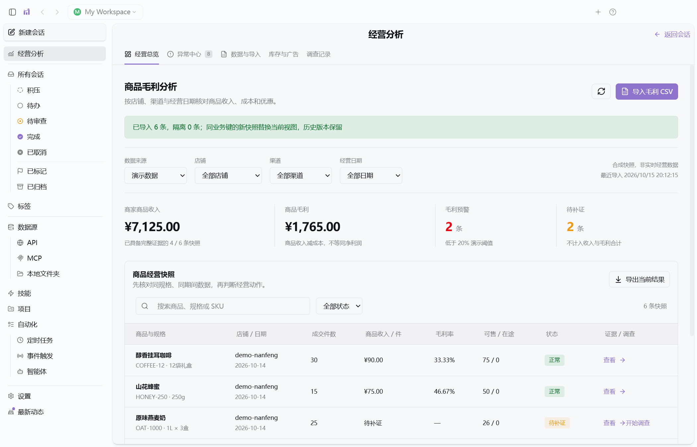

# Merqo

**An AI-powered desktop workspace for retail analytics, risk detection, and evidence-backed operational investigations.**

Merqo brings promotion margins, stockout risks, and advertising ROAS into one desktop workspace. Business metrics and anomaly rules are calculated by deterministic code; a bounded, read-only investigation workflow adds evidence-linked explanations and scenario comparisons for all three scenarios.

Built on the Craft Agents desktop codebase using **Electron, React, TypeScript, Bun, and SQLite**.

> Development prototype for Windows. The current desktop application, launch scripts, and local configuration names still use **RetailPilot**. Merqo is the repository name. Sample results are synthetic and do not represent real business performance.



## Features

| Scenario | Available today |
| --- | --- |
| Promotion margins | Merchant discounts and subsidy treatment, unit revenue and gross profit, margin alerts, missing-evidence checks |
| Sales and stockout risk | Adjacent-window sales comparisons, available inventory, coverage days, lead-time buffer and expected inbound arrival checks |
| Advertising performance | Comparable-window ROAS, relative changes, click conversion rates and attribution consistency checks |
| Data and evidence | CSV mapping and preview, validation, quarantined rows, duplicate protection, versioned rules, source hashes and quality reports |
| Three-scenario investigations | Read-only tool loop, cited observations and hypotheses, alternative explanations, two deterministic scenarios, sequential Reviewer and persistent history |

All three analytical scenarios work with synthetic data or imported CSVs **without model credentials**. All three investigations support a configured API model or an explicitly labeled offline rules demonstration.

### Data handling

- Synthetic and user-imported data remain separate.
- Missing values remain unknown; they are never silently converted to zero.
- Inbound stock does not count as immediately available inventory.
- ROAS comparisons require adjacent, equal-length periods and matching attribution windows.
- Corrections replace the current snapshot while preserving imported row history and batches.
- Each workspace has isolated SQLite databases. Investigation records retain the selected evidence snapshot across restarts.


## Quick start

### Prerequisites

- Windows; development validation was performed on Windows 11. Other desktop platforms have not been validated for this fork.
- Bun and Node.js. Development validation used Bun 1.4.2, Node.js 24 and Electron 39.2.7.
- Git for Windows / Git Bash for inherited Agent functionality.
- Network access for the initial dependency installation.

```powershell
git clone https://github.com/RXQ6/Merqo.git
cd Merqo
bun install --frozen-lockfile
bun run retail:build
bun run retail:start
```

The initial build compiles the desktop application and supporting processes. Subsequent launches can use `bun run retail:start` directly.

If the Electron binary download fails, an optional mirror can be configured before retrying:

```powershell
$env:ELECTRON_MIRROR = 'https://npmmirror.com/mirrors/electron/'
node node_modules/electron/install.js
```

### Explore the demo

The current application UI is primarily Chinese:

1. If prompted for a model connection, choose **稍后设置** (Set up later).
2. Open **经营分析** (Retail analysis) in the desktop sidebar.
3. Open **数据与导入**, then select **载入演示数据** to load all three scenarios.
4. Open **库存与广告** to inspect inventory and advertising evidence.
5. Open **异常中心** to review the combined anomaly list.

Expected demo results:

| Check | Expected value |
| --- | --- |
| Eligible product revenue / gross profit | CNY 7,125.00 / CNY 1,765.00 |
| TEA-500 promotion margin | 14.29% |
| TEA-500 immediately available stock / coverage | 40 units / 2 days |
| CMP-TEA current / baseline ROAS | 1.80 / 3.00, a 40% decline |
| Combined anomalies, including evidence gaps | 8: four margin, two inventory, two advertising |

The sample 20% thresholds and two-day inventory buffer are **versioned demonstration rules**, not universal operating targets. Product gross profit excludes advertising, shipping and platform commissions.

## Investigations

Select **开始调查** next to a margin, inventory or advertising alert, such as TEA-500.

The investigation workflow queries four scoped, read-only tools, separates observations from hypotheses, links claims to evidence, compares two scenarios and runs a sequential Reviewer. Calculations, evidence-reference checks, missing-data blocks and persistence are controlled by code.

- Supported inference protocols: Anthropic Messages and OpenAI Chat Completions compatible endpoints.
- Supported authentication: API key, bearer token, or no authentication for a configured local compatible endpoint.
- Select the connection as the workspace or global default in Settings.
- Subscription OAuth, cloud identity and Responses-only connections are not supported by this investigation adapter yet.
- Model failures produce a visible failure state. They never automatically become offline results.
- **运行离线规则演示** explicitly runs a fixed-rule demonstration and labels the report accordingly.

Runs are limited to five minutes, twelve model decisions and one Reviewer call, with at most two active investigations per workspace. Intermediate evidence and reports persist. Interrupted runs become retryable failures after their original deadline; automatic model resumption is not implemented.


## CSV examples

Download templates in the application or use [fixtures/retail](fixtures/retail):

| Files | Purpose |
| --- | --- |
| `demo-operations.csv` | Promotion margin snapshots |
| `inventory-demo.csv`, `ads-demo.csv` | Stock and advertising demo data |
| `inventory-errors.csv`, `ads-errors.csv` | One accepted row and two quarantined rows each |
| `inventory-corrected.csv`, `ads-corrected.csv` | Replace the current snapshot and retain history |

CSV imports use UTF-8, support a BOM and column mapping, and are bounded to 2 MB and 10,000 rows per file. Advertising money uses integer CNY minor units. Empty numeric cells represent unknown values. See the data contracts before importing operational reports.

## Architecture

```text
React desktop UI
    │ typed, allowlisted IPC
Electron main process
    ├── Trusted workspace scope and bounded worker requests
    ├── Inference adapter → configured API / local endpoint
    └── Bun data worker
          ├── Deterministic margin, inventory and ROAS rules
          └── Per-workspace SQLite snapshots, history and investigations
```

The retail investigation loop exposes scoped read-only data tools. It does not expose shell commands, arbitrary file access, arbitrary SQL or business execution. The inherited general Agent workspace is a separate capability surface and does not constitute retail business authorization.

Standalone MCP: `bun scripts/merqo-retail-mcp.ts --workspace <absolute-workspace> --scenario margin|inventory|ads --record <id>`. Each process freezes one existing record, exposes four strict read-only tools and serves its versioned Skill. The desktop currently calls the same domain functions directly; MCP transport integration into its investigation loop remains pending. See [setup and acceptance](docs/M2-investigation.md).

Key paths:

```text
apps/electron/src/renderer/retail/   Retail pages and investigation views
apps/electron/src/main/retail*.ts   Workspace-scoped IPC and inference adapter
packages/retail-domain/src/         Data contracts, calculations, stores and Agent core
scripts/retailpilot-*.ts            Local launch and data worker entry points
fixtures/retail/                    Reproducible CSV examples
docs/                              Design, acceptance and verification records
```

The launcher stores local state under `.runtime/config` and `.runtime/chromium`; these folders are ignored by Git. It does not migrate existing Craft credentials. Configure model credentials through the application's Settings; the inherited `.env.example` is not required for the three analytical demos.

## Verification

Run after building:

```powershell
bun run retail:check
bun run retail:check:mcp
bun run typecheck:all
bun test apps/electron/src/transport/__tests__/channel-map-parity.test.ts
node scripts/retailpilot-m1-e2e.cjs
```

The recorded verification includes 60 domain/persistence tests, two transport contract tests, type checks, development builds and a two-phase native Electron workflow with restart recovery. The desktop test uses isolated profiles and writes local reports under `artifacts/`.

Inference transport tests use a **local HTTP contract fixture**. They verify the adapter and tool loop, not real-model reasoning quality. A live DeepSeek V4 Flash smoke evaluation completed all three synthetic scenarios with cited reports and Reviewer passes. This is a three-case engineering check, not a full business-quality benchmark; see the [evaluation record](docs/M2-verification.md).

## Status and roadmap

- **Available:** three analytical workflows, three scoped investigation workflows, conditional plans, Reviewer, persistent evidence, standalone read-only MCP and versioned Skills.
- **Next:** close remaining M2 integration gaps and add M3 approval contracts and simulated execution. Historical Case retrieval and desktop-to-MCP transport integration remain pending.
- **Later:** decision approval, authorized simulated execution, reconciliation, review workflows and Windows packaging.

No real ERP or advertising platform integration, business writes, production multi-user authorization or installer is delivered yet. Snapshot data is not live monitoring. Combined upper-bound data-volume performance is not validated; server-side pagination remains needed before large-scale use.

## Documentation

- [Three-scenario acceptance and data contracts](docs/M1-three-scenarios.md)
- [Three-scenario verification record](docs/M1-signals-verification.md)
- [Three-scenario investigation setup and acceptance](docs/M2-investigation.md)
- [Investigation verification record](docs/M2-verification.md)
- [Domain contracts](docs/domain-contracts.md)
- [Original upstream README](docs/upstream-README.md)

Most implementation and acceptance documents are currently written in Chinese.

## License and attribution

Merqo is derived from a user-provided **Craft Agents 0.11.4** source snapshot. The repository preserves the original source baseline and subsequent development commits. See the [upstream SHA-256 manifest](docs/baseline/upstream-manifest.json) for provenance.

Distributed under [Apache License 2.0](LICENSE). Original attribution and brand policies are retained in [NOTICE](NOTICE) and [TRADEMARK.md](TRADEMARK.md). Merqo is an independent derivative project and is not an official Craft product.
