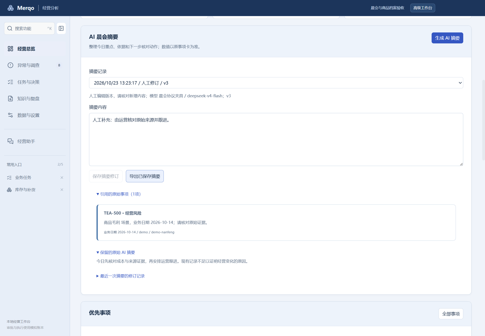
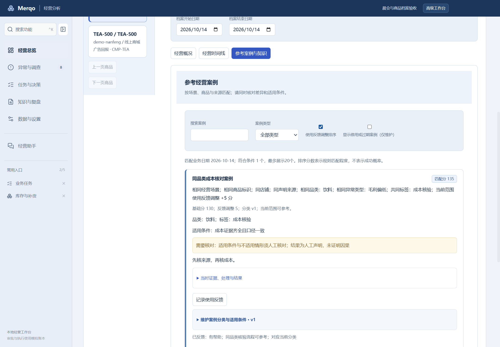

# Merqo

**面向零售经营的 AI 桌面工作台，让数据分析、异常调查、任务跟进与经营知识连成一条线。**

[English](README.md) · **简体中文**

Merqo 将导入的经营数据串联为：发现异常、发起调查、补充证据、比较方案、创建任务、本地模拟审批与处理、到期复查、归档经营案例。业务指标由确定性代码计算，AI 用于解释证据与整理定性建议。

基于 Craft Agents 桌面代码开发，使用 **Electron · React · TypeScript · Bun · SQLite**。软件界面目前主要为中文，README 提供中英文两版。

## 下载与安装

**Windows x64 预览版：0.1.0-beta.13** · 发布记录日期：2026-10-24

[**下载 Windows 安装包**](https://github.com/RXQ6/Merqo/releases/download/v0.1.0-beta.13/Merqo-Setup-0.1.0-beta.13-x64.exe) · [发布说明](https://github.com/RXQ6/Merqo/releases/tag/v0.1.0-beta.13) · [SHA-256 校验文件](https://github.com/RXQ6/Merqo/releases/download/v0.1.0-beta.13/SHA256SUMS.txt)

安装后，从桌面快捷方式或开始菜单打开 **Merqo**。软件内的更新检查读取本仓库 GitHub Releases，包含 beta 版本，并提供手动下载安装入口。

> 当前为未签名的 Windows 预览版，已在本机 Windows 11 验收。数据库升级到 schema13 前会自动创建备份；请勿用 beta.11 或更旧版本直接打开已升级工作区。详见[安装与数据位置](docs/windows-preview.md)和 [beta.13 验收记录](docs/release-beta13-2026-10-24.md)。

## 经营使用链路

**数据接入或导入 → 发现异常 → 发起调查 → 补充证据 → 比较方案 → 创建任务 → 审批与处理 → 到期复查 → 沉淀经营案例。**

本地流程已实现。审批和执行属于本地模拟，真实平台写回与经过身份认证的多人审批仍未交付。

| 导航分组 | 主要入口 | 可以做什么 |
| --- | --- | --- |
| 经营总览 | 经营晨会、商品经营档案、毛利、库存、广告分析 | 查看今日重点，追溯商品的证据、调查与任务 |
| 异常与调查 | 异常中心、业务实体、调查记录、经营巡检 | 发起限定范围的调查、补充证据、保留调查经过 |
| 任务与决策 | 业务任务、复查与提醒、决策草稿、审批、执行与补偿记录 | 分配跟进工作，查看有版本记录的本地模拟动作 |
| 知识与复盘 | 经营知识中心、经营复盘 | 维护 Wiki 知识、比较观察结果、归档经营案例 |
| 数据与设置 | 平台接入、数据与导入、商品映射、经营规则 | 配置数据源、审核导入、维护业务口径 |

可使用功能搜索（**Ctrl+K**）和常用入口，在五组导航之间快速定位功能。

## beta.13 新增：本地采购到履约闭环

- **库存与补货 → 财务与入库处理**：登记采购应付、付款、供应商退款，预览确认到货入库，保留凭证和财务复查。
- **库存与补货 → 条码与波次**：维护条码及库位定位标签，按先到期先出生成多订单波次，核对扫码后统一预留库存。
- **库存与补货 → 订单关联发货**：将明确的已付款订单行与预留批次关联，一次确认同时记录交易发货和库存扣减，支持本地回读复查。
- 调查冻结同范围交易、采购、库存和财务证据，任务与案例保留相同证据索引。

这些操作记录本地业务台账；付款不代表银行到账，发货不代表物流签收，库位标签不提供独立库位库存核算。详情及验收证据见[本地业务闭环记录](docs/local-business-closure-2026-10-24.md)。

## beta.12 新增功能

### 可编辑的 AI 晨会摘要

打开 **经营总览 → 经营晨会 → 生成 AI 摘要**。使用已配置模型，将冻结晨会整理为定性的经营重点和跟进建议，并展示原事项引用。

- 支持人工编辑与保存，保留原始 AI 内容和修订历史。
- 支持将已保存的摘要及来源导出为 TXT。
- 模型只接收晨会前二十项元信息，不发送原始交易记录。格式异常、未知引用或超时会显示失败状态，规则晨会仍可继续使用。



### 商品分类与可解释的案例复用

打开 **经营总览 → 商品经营档案**，维护商品品类和标签。在 **参考经营案例** 中维护案例品类、标签、异常类型、有效日期、适用条件和不适用情形。

匹配结果解释业务范围、品类、异常类型与标签的共同点，并提示需要核对的差异。当前商品范围和案例分类版本的“有帮助 / 不适用”反馈分别调整 **+5 / −10 分**，可关闭反馈调序。分类变化后旧反馈保留，但不再参与排序。停用或过期案例可以维护，不能新增引用。

历史调查和任务中的案例分类版本保持冻结。匹配分数表示规则匹配程度，不代表成功概率，也不表示模型训练。



## 现有核心能力

| 能力 | 已实现内容 | 适用边界 |
| --- | --- | --- |
| 经营分析 | 促销毛利、库存覆盖与补货风险、广告 ROAS 和归因口径检查 | 缺少证据保持未知；商品毛利不等于净利润 |
| 异常调查 | 限定范围的只读 MCP 工具、冻结证据、观察与假设、备选方案、Reviewer、Markdown/JSON 导出 | 离线规则明确标注；模型失败不会自动变为离线结果 |
| 任务与跟进 | 负责人、截止日期、状态、提醒、复查、快照观察和不可变经营案例 | 本地定时任务要求软件保持运行 |
| 经营知识中心 / Wiki | Markdown 编辑、搜索、版本历史、已发布知识引用、Markdown 与飞书文档源只读同步 | 外部源权限及真实服务授权仍需单独验收 |
| 数据导入 | CSV 映射、预览、隔离错误行、去重、来源声明、审核后导入业务事件 | 操作者声明的来源不等于经过平台认证的身份 |
| 平台接入准备 | 配置向导、只读检查、分页同步、断点、暂停/继续/重试、增量窗口 | 尚未连接真实抖店 |
| 交易与库存 | 交易/退款事件、声明成本、贡献比较、促销赠品分摊、采购、效期、仓库台账、调拨、FEFO 拣货规划 | 属于本地声明台账；没有真实 ERP/WMS 写回 |
| 模拟决策 | 版本化草稿、审批、执行回执、回读、补偿、独立执行批次、结果待确认恢复 | 单用户本地模拟，不是生产权限体系 |
| 经营备份 | 密码加密业务数据库备份、预览、恢复到独立工作区 | 不包含会话、模型密钥和附件；恢复后的执行仍锁定 |

详细业务约定与限制见下方[文档索引](#文档索引)。

## 快速体验

1. 安装 Merqo，或按下方步骤从源码启动。体验本地分析时可暂缓模型配置。
2. 点击 **经营分析**，通过功能搜索打开 **数据与导入**，载入演示数据。
3. 打开 **经营晨会** 查看重点，或到 **异常中心** 发起毛利、库存、广告调查。
4. 无模型密钥时选择 **运行离线规则演示**；使用 AI 时，在设置中配置受支持的模型连接，并设为工作区或全局默认连接。AI 晨会摘要需要模型配置。
5. 创建业务任务，记录跟进证据，结束任务并归档案例；到 **商品经营档案 → 参考案例与知识** 复用经验。
6. 打开 **知识与复盘 → 经营知识中心**，创建 Wiki 内容或配置只读文档源。

调查适配器支持 Anthropic Messages 和 OpenAI Chat Completions 兼容端点，认证方式包括 API Key、Bearer Token，以及配置好的本地免认证端点。暂不支持订阅 OAuth 或仅提供 Responses 的端点。DeepSeek 模型可通过配置连接动态发现。

[fixtures/retail](fixtures/retail) 提供毛利、库存、广告、组合装、赠品和会员价等演示 CSV；软件内也可以下载模板。演示数据均为合成数据，与用户导入的数据分开存储。

## 从源码开发与启动

已验证的开发环境：**Windows 11、Bun 1.4.2、Node.js 24、Electron 39.2.7**。继承的 Agent 功能需要 Git for Windows / Git Bash。首次安装依赖需要网络。

```powershell
git clone https://github.com/RXQ6/Merqo.git
cd Merqo
bun install --frozen-lockfile
bun run retail:build
bun run retail:start
```

首次构建后，再次启动执行 `bun run retail:start`。源码启动器将本地状态保存在被 Git 忽略的 `.runtime/config` 和 `.runtime/chromium` 中。模型密钥在软件设置中配置，基础分析演示不需要 `.env`。

生成 Windows 安装包：

```powershell
bun run retail:dist:win
```

打包脚本按明确的运行时文件清单构建。个人 `.runtime` 配置、会话、导入的经营数据和密钥不会打入安装包；演示样例为合成数据。

## 验收与交付状态

**beta.13** 的验收记录如下：

| 检查项目 | 结果 |
| --- | --- |
| 领域回归与领域类型检查 | 425 项测试通过，3,833 次断言 |
| 打包后的 Electron 流程 | 33 组通过，覆盖本地财务/履约、晨会/商品、Wiki及原有业务链路 |
| 桌面构建 | Electron 类型检查及 main/renderer 构建通过 |
| Windows 安装器 | 实际 beta.12→beta.13 升级、同版重装、卸载通过；原记录及分类保留 |
| GitHub CI | 合并前通过 |

[验收报告与截图](docs/local-business-closure-2026-10-24.md) · [发布及安装器证据](docs/release-beta13-2026-10-24.md)

开发时可运行：

```powershell
bun run retail:check
bun run retail:check:mcp
bun run typecheck:electron
bun run retail:eval
```

归档的固定合成业务基准有 **48 个可执行案例通过**，与 414 项领域回归不是同一组统计。`bun run retail:eval --release-gate` 仍会因生产发布条件未满足而退出失败；本地测试通过不代表整个 PRD 已达到生产就绪状态。

### 仍需完成的范围

- 真实模型的经营质量评估，以及更多对抗、性能验收。
- 干净 Windows 环境、跨 Windows 版本兼容性测试和安装包签名。
- 经过身份认证的平台适配器、真实服务数据完整性、生产写回/回读及多人权限。
- 后续财务/履约对接，以及将新增业务台账接入 Agent 证据链。

抖店和安卓暂缓。软件关闭后没有常驻后台服务。合成演示不能证明真实平台交易、实时库存或经营动作的因果收益。

## 文档索引

| 主题 | 文档 |
| --- | --- |
| 当前发布 | [beta.13 发布记录](docs/release-beta13-2026-10-24.md) · [打包验收](docs/local-business-closure-2026-10-24.md) |
| 晨会、商品档案与案例 | [S0–S4](docs/experience-S0-S4-2026-10-23.md) · [beta.12 增强](docs/experience-enhancement-2026-10-23.md) |
| 本地业务链路 | [三批交付](docs/three-batch-delivery-2026-10-22.md) |
| Wiki | [W1–W3 设计与交付](docs/wiki-W1-W3-2026-10-22.md) |
| 平台接入准备 | [同步任务](docs/P1-sync-workflow-2026-10-20.md) · [审核导入](docs/P1-ingestion-workflow-2026-10-20.md) |
| 交易与业务台账 | [促销](docs/P1-promotion-eligibility-2026-10-21.md) · [采购](docs/P1-procurement-2026-10-21.md) · [仓库](docs/P1-warehouse-ledger-2026-10-21.md) · [FEFO](docs/P1-warehouse-picking-2026-10-21.md) |
| 备份与安装 | [备份恢复](docs/P1-backup-recovery-2026-10-21.md) · [Windows 预览版](docs/windows-preview.md) |
| 评估与更大范围 PRD 缺口 | [业务基准](docs/M5-business-evaluation.md) · [真实模型评估](docs/M5-live-evaluation.md) · [10月20日业务路线记录](docs/development-progress-2026-10-20.md) |

详细设计和验收文档主要为中文。各日期记录描述各自交付范围；当前安装包状态以 beta.12 发布记录为准。

## 技术架构

```text
React 桌面界面
    → 类型化、白名单 IPC
Electron 主进程
    → 可信工作区范围、密钥、模型适配器
Bun Worker + 限定范围的只读 MCP
    → 确定性规则、版本化台账、证据核验
工作区独立 SQLite
    → 快照、调查、任务、Wiki 与经营案例
```

经营工作区中的通用 Agent 工具受只读限制，包括 Auto 模式。专用模拟操作使用独立审批流程；编程请使用单独的普通工作区。

主要源码目录：[桌面界面](apps/electron/src/renderer/retail)、[主进程](apps/electron/src/main)、[领域模块](packages/retail-domain/src)、[脚本](scripts)、[样例](fixtures/retail)。

## 许可证与来源

Merqo 基于 **Craft Agents 0.11.4** 源码快照开发。部分内部路径保留 RetailPilot 名称；上游 0.11.4 不是 Merqo 的发布版本。来源见[上游文件校验清单](docs/baseline/upstream-manifest.json)和[原始上游 README](docs/upstream-README.md)。

[Apache License 2.0](LICENSE) · [NOTICE](NOTICE) · [TRADEMARK](TRADEMARK.md)。Merqo 是独立衍生项目，不是 Craft 官方产品。
