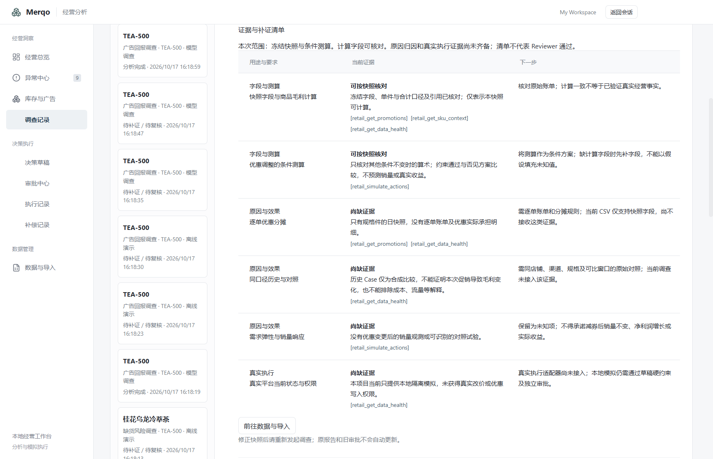

# M4 毛利证据分层与 Reviewer 专项验收

新毛利报告增加可选 evidenceAssessment（margin-evidence-v1），在数值与四个工具引用核验后由代码生成。六项要求分为字段与测算、原因与效果、真实执行三类。计算支持仅指冻结字段内部可核对；日快照、合成历史 Case 均不能补出逐单分摊、因果对照或真实平台权限。

界面沿用现有浅灰背景、白色区块、Segoe UI/Yahei 和细分隔线，使用一张三列表说明用途、当前证据和下一步，不新增导航。当前导入只支持快照字段，清单明确写出逐单等证据尚未接入；不假装点击导入即可补齐所有证据。

最终 unknowns 在 Reviewer 前合并，保证模型复核的披露与保存、导出的正文一致。模型的 passed / needs_evidence / rejected 均原样保留，已有确定性缺字段降级规则不变。历史报告不回填、不重绑旧审批；新报告哈希自然绑定新增清单。Markdown 与 JSON 均携带清单。

专项固定十例覆盖有限条件分析、缺成本、无依据归因、混淆净利润、承诺销量收益、越权、报告指令注入、诚实假设、不可行方案、隐瞒缺口。评测输入不含预期答案，最多二十次模型调用，一轮固定样例不循环采样求通过。该集只评 Reviewer，不代表端到端 Agent 或 PRD 的四十八例评测。

首轮真实模型专项结果及工程验证将在本轮验证记录中如实保留。不能因错误报告被拦截就声称模型通过完整标准，也不能把待补证自动改成通过。

验收：重启后在经营分析中对毛利记录重新调查，打开“证据与补证清单”，确认六项要求、引用及具体下一步。点击“前往数据与导入”进入现有数据页；修正快照后从最新记录重新调查，旧报告保持原样。历史报告没有新清单属正常。

## 本轮真实模型结果

固定十例首轮使用十一轮调用，严格结论匹配 5/10。六个错误或危险报告全部被阻止通过，其中两例为 needs_evidence 而非预期 rejected；三个有限条件正例均为 needs_evidence。这个分数发生在最终未知项披露顺序修正之前，保留原结果，不重复抽样覆盖失败。

随后独立运行一次修复后的毛利真实模型合成流程，六次调用，Reviewer passed，模拟审批、隔离执行、回读核对与复盘 Case 均完成。该流程使用真实模型和实际只读 MCP；批准者、执行者、复盘者仍为测试脚本的本地模拟角色，数据和观察窗仍为合成，不代表真人审批或真实经营收益。

这证明毛利链路已有一次可运行的真实模型合成样例，不证明反复运行的稳定性，也不代表十例专项或 M5 验收通过。下一阶段补齐 P0 领域调度、手动补跑与去重，同时保留 Reviewer 偏保守及严格判别问题进入后续评测。

[机器验证记录](verification/margin-evidence-2026-10-17.json)

## 工程验证

170 项领域测试（899 次断言）、领域及 Electron 类型检查、完整构建、最终 renderer 构建、8 项实际 MCP 检查通过。桌面专项 7 项通过，验证六项清单、离线权限保持、JSON 导出、补证入口及单窗口范围。已检查实际截图的三列表格换行与按钮可见性。

