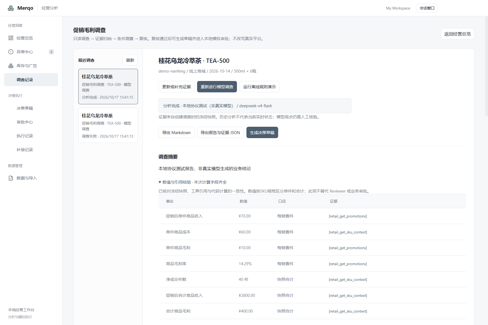

# 毛利报告数值与引用核验

毛利模型报告中的金额、比例、件数和单件/合计口径不再由模型自由填入。模型输出定性摘要、假设、未知项及两个条件方案的解释；模型 observations 必须为空，数值及数据质量观察均由代码生成；代码从冻结快照、四个实际工具结果及确定性方案构造数值事实。模型文本出现数字或中文数词加经营单位时由契约拒绝，在既有格式纠正预算内提示更正；不静默修改原模型输出。

数值核验逐项检查唯一工具事件、冻结记录 ID 的证据索引、金额和销量、计算口径与规则阈值，以及条件方案。任何计算、单位或引用矛盾均终止报告，不调用 Reviewer、不生成批准。缺字段保持未知，核验通过不等于数据齐全，不替代 Reviewer 或执行硬约束。

报告追加可选 numericAudit，包含契约版本、数值事实、单位、粒度和证据 ID。旧报告不回填，不改变旧 Reviewer 或旧批准。Markdown/JSON 导出及草稿 reportHash 自动绑定该字段；不新增数据库表或迁移。

本轮仅覆盖毛利；库存与广告保持原契约。文本限制覆盖阿拉伯数字、全角数字与常见中文经营数词，不保证识别英文数字词、罗马数字、隐含数量及所有定性语义；它不是通用语义真实性证明，业务因果、定性推理与未覆盖表达仍需模型 Reviewer 和人工核验。真实模型只做小样本回归，不冒充行业 Benchmark。

## 验收与边界

在新毛利调查中打开“数值与引用核验”，应看到促销后单件收入、合计收入、商品毛利、商家券原值与方案值及减少额，并能追到冻结工具证据。TEA-500减少额为500分/件，不是200分；单件收入7000分与合计280000分分别展示。缺成本时保持null和待补证，不补成零。

JSON与Markdown完整快照携带numericAudit；保存草稿时reportHash绑定该报告。旧报告不自动追加此核验；新调查须重新生成草稿，不迁移旧批准。此功能不改变30分钟草稿时效、Reviewer要求、方案硬约束或CSV仅分析范围。

工程验证：164项领域测试、841次断言及类型检查通过；全项目类型、完整构建及最终主进程构建通过；实际MCP 8项检查通过。覆盖单件/合计、优惠差额、负毛利、零销量、空成本、金额单位、阈值、导入时间、引用缺失/重复/跨记录、被篡改工具与格式纠正。矛盾工具不进入Reviewer，核验记录重启保留，旧报告不回填。

真实模型首轮6次调用，Reviewer rejected：模型定性观察中出现数据缺口的矛盾表述。随后契约改为模型observations必须为空，数值与数据质量观察均由代码生成；不静默删除被接受的模型断言。第二轮7次调用（含一次有界格式纠正），Reviewer明确确认单件/合计、优惠差额、比例和证据引用一致，但因逐单分摊及历史对照不足而保持needs_evidence。两轮均未生成审批或执行，旧拒绝结果保留。

这仍不是毛利真实模型闭环通过，也不是因果或经营效果证明。下一步应建立Reviewer和归因假设的专项评测，区分已支持的条件分析与尚缺因果证据的结论；不得用此数值核验代替复核。领域调度/补跑/去重与M5仍未在本轮开发。

机器记录见[同日验证](verification/margin-numeric-2026-10-17.json)。本地协议桌面回归另行记录，不混称真实模型UI全链路。

原生桌面完整首轮 58 项、同配置重启 18 项通过；检查数值核验表、五元商家券差额、JSON导出、独立窗口以及三场景审批/执行/补偿/复盘回归。模型响应为本地协议fixture。

