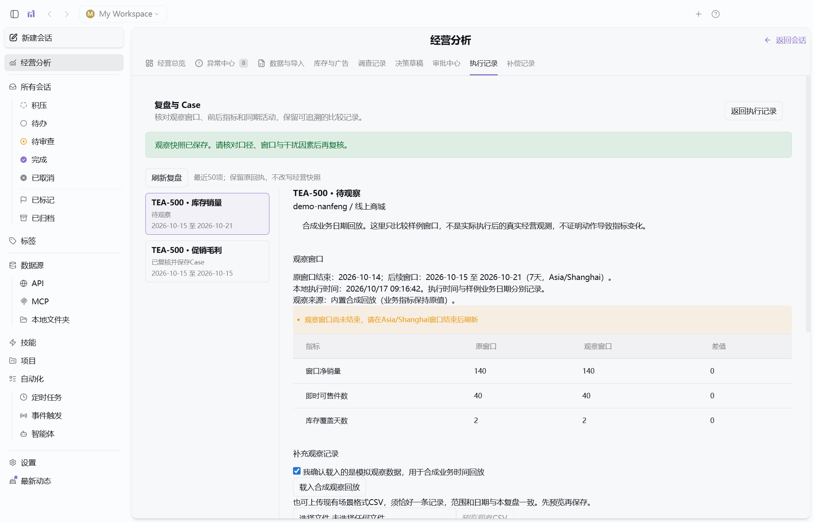

# M4 复盘与 Case 验收

## 启动

退出旧窗口，从本轮已构建的项目启动：

```powershell
cd "D:\helson-skills\craft-agents-oss-main\retailpilot-agent"
bun run retail:start
```

如果是新克隆或没有最新构建，先运行`bun run retail:build`。本轮保留原桌面布局，从“经营分析 → 执行记录”进入。

## 从回执建立复盘

1. 先完成一个符合约束的演示动作：调查、模型Reviewer通过、草稿、分别审批、本地模拟执行。离线报告不能审批；已有成功回执可以直接使用，不重复执行。
2. 在成功回执旁点击“创建或查看复盘”。也可从执行记录页点击“复盘与 Case”查看最近50项。
3. 核对原调查、批准、回执和观察窗口。日毛利为相邻1天；库存/广告为原快照后相邻等长窗口，窗口由服务端推导。
4. 勾选“确认仅用于合成复盘”，点击“载入合成观察回放”。样例保持销量、库存和广告效率原值；库存预计到货日按回放天数平移，不模拟到货。默认原快照结束2026-10-14：毛利观察窗2026-10-15；7天库存/广告观察窗2026-10-15至2026-10-21。
5. 在Asia/Shanghai该窗口结束前显示“待观察”，不能提前复核。窗口结束且记录完整时，展示原值、观察值和差值；金额显示为元，比例显示为百分比，比例差值显示为百分点；没有记录为待补证。

这使用**合成业务日期时间线**。回执中的真实本机执行时间单独展示，不能把业务回放数据称为实际执行后观测到的效果。

## 上传观察记录

使用与原场景相同的CSV字段契约，须恰好一条有效记录；通过“选择复盘观察CSV → 预览观察CSV → 保存模拟观察CSV”保存。文件最多2MB，必须明确声明为模拟观察，来源标记为用户上传。

- 店铺、渠道、SKU、日期必须匹配；毛利/库存规格、币种、仓库或Campaign等身份也须一致。
- 库存/广告必须等长相邻，baseline_end_date为原快照日期；原窗口销量、广告对照金额/点击转化和归因口径须与原记录一致。
- 范围、日期或口径冲突会阻断保存；无成本等可表达的缺失数据保留未知，不变成零。关键缺失时不能复核成有效比较，但可记录“证据不足，无法判断”。
- 预览与提交摘要不符、并发更新导致版本变化时，刷新后重新核对。
- 保存观察只追加复盘版本，不修改原经营快照或执行账本。

## 复核和Case

填写“复盘结论”和“同期活动与干扰因素”，明确未核实的促销、季节变化、库存/归因因素。勾选确认后，点击“复核并保存 Case”。

结论只能是“仅确认前后比较，不判断因果”或“证据不足，无法判断”。保存后只读，重复相同提交返回原Case，不能覆盖历史。版本、观察摘要与回执引用保留；关联补偿记录另行展示，不能把原动作成功理解为当前仍保持该动作。

## 用Case开展后续调查

已复核的**内置合成回放**提供“运行后续离线调查”和“开始后续模型调查”。点击后明确把本条合成观察导入演示来源，并开始调查，不执行经营动作。用户上传记录不会被这个入口自动提升为内置演示数据。

在新调查展开“创建调查时冻结的历史 Case”，应看到符合条件的Case；`retail_get_sku_context`的MCP证据里也应包含同一Case。

检索受workspace、店铺、渠道、SKU、场景、规格和仓库/Campaign限制；只供demo来源使用，窗口结束不晚于本轮业务日期、人工复核时间不晚于本轮开始时刻，最多5条。旧调查不会回填后续Case；CSV经营分析不会引用合成Case。Case文本是业务材料，不改变工具权限；模型evidenceIds引用所在sku_context工具的证据ID，Case ID放在说明文字中。

离线后续调查仍明确标注未调用模型、不能进入审批。模型后续调查需要用户配置连接；本轮未新增真实模型质量或付费调用验收。

## 重启与导出

退出重启后，复盘版本、窗口、结论、干扰因素、Case及新调查冻结上下文应保留，已复核项无再次覆盖入口。原调查Markdown/JSON导出包含关联复盘、Case与来源绑定，后续调查导出包含冻结的Case上下文。

本轮决策库升至v6，v1-v5升级前生成备份，保留旧执行/补偿/批次历史，未来版本拒绝。当前仍不含真实经营效果复盘、领域定时调度、生产身份或完整PRD发布门禁。



