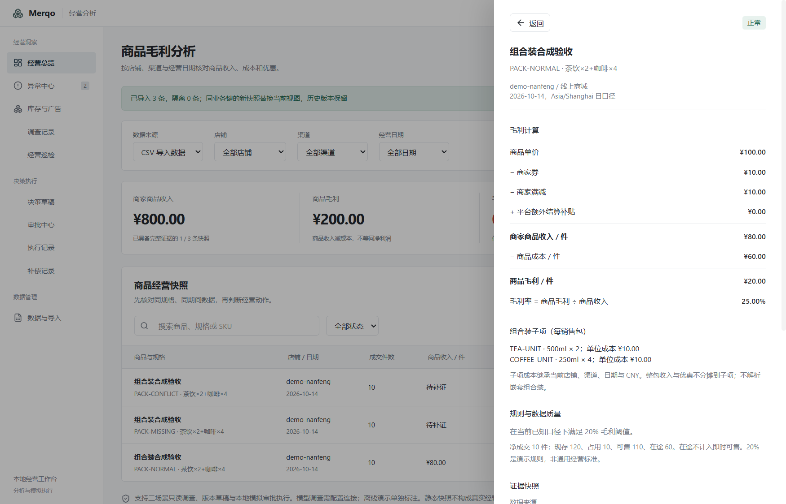

# M5 组合装：一层销售包成本契约

后续源码更新：赠品三个样例已实现，见 [赠品契约](M5-gift-contract.md)；本文保留组合装轮次的范围和验收数字。

本轮实现组合装三个固定业务样例：正常、整包成本冲突、缺少子项。源码功能已更新；现有 `0.1.0-beta.1` 安装包不包含本轮改动，不把开发构建验收等同于新安装包验收。

## 导入与计算

进入「经营分析 → 数据与导入 → 下载组合装示例」，导入下载的 CSV。仓库样例为 `fixtures/retail/demo-bundles.csv`。

原 17 个 CSV 字段保持必填，新增两个可选字段；旧文件和字段映射仍可导入，旧文件不增加空映射字段，避免改变重复导入摘要。

| 字段 | 契约 |
| --- | --- |
| `product_type` | `single` 或 `bundle`；旧 CSV 未提供时沿用单销售 SKU 口径，不根据商品名猜测组合关系 |
| `bundle_components` | JSON 数组；每项为 `sku_id`、`spec`、`quantity`、`unit_cost_minor` |

示例子项 JSON（CSV 中需按标准双引号转义，下载样例已处理）：

```json
[{"sku_id":"TEA-UNIT","spec":"500ml","quantity":2,"unit_cost_minor":1000},{"sku_id":"COFFEE-UNIT","spec":"250ml","quantity":4,"unit_cost_minor":1000}]
```

子项继承该行店铺、渠道、日期和 CNY；金额为分，成本为每子项单位成本，数量为每销售包所含件数。整包成本必须由 `Σ(quantity × unit_cost_minor)` 核对一致。整包收入仍为整包标价减商家券、满减，加已确认额外平台结算补贴；销量按包计。

正常样例：整包标价 100 元，券与满减各 10 元，子项合计成本 60 元；每包收入 80 元、毛利 20 元、毛利率 25%，10 包合计毛利 200 元。

## 拒绝与待补证

- 无效 JSON、非整数/非正数量、负数或小数成本、空 SKU/规格、超出数量/金额范围、未知子项字段、子项自带币种或嵌套结构：隔离错误行。
- 未声明组合装却提供子项、缺少/空子项、缺子项成本、重复子 SKU、包含自身 SKU、成本合计冲突或超过整包金额上限：保留快照，状态为待补证，不产生确定毛利。
- 同店铺、渠道、来源的同 SKU 跨日期若规格或子项 SKU/规格/数量发生变化：要求身份复核。子项顺序不影响身份；成本变化不改变组成身份。
- 已识别的组合装业务列不能通过置空或改映射被静默忽略。自定义列名可通过现有映射入口指定。

## 调查、审批与复盘

只读 SKU 工具返回冻结的商品类型与子项明细。毛利数值核验检查工具明细与原始快照相同；模型无法通过替换子项让报告通过。

待补证项不能通过动作约束或提交审批。用户 CSV 继续仅供分析，不因支持组合装而获得模拟执行权限。本地合成协议测试覆盖组合装调查、批准、模拟执行、回读、观察及 Case；使用固定模型协议夹具，不构成真实模型质量证据。

复盘观察必须与原包组成相同；Case 检索增加组成约束。后续合成观察转 CSV 时以 JSON 序列化子项，保留明细。历史普通 SKU Case 无新增字段时按原单 SKU 范围处理。

规则版本升级为 `retail-margin-v2`，原规则记录、导入历史、冻结调查不覆写；当前快照按新规则计算，旧草稿按既有版本校验重新核对。数据库表结构未改变。

## 边界

只实现一层包明细与整包成本核对；不做外部商品目录匹配、嵌套包展开、子项收入/优惠分摊、跨币种或仓库库存拆解。赠品、会员价和无货价格另有九个未支持业务样例。不能从商品名称判断未声明组合装，也不能把一份完整明细解释为已验证真实来源。

## 验证入口

```powershell
bun run retail:check
bun run typecheck:electron
bun run retail:eval --release-gate
bun run retail:build
node scripts/merqo-bundle-desktop-check.cjs
```

发布门禁当前应退出 1，仍然 `releaseReady: false`。桌面专项使用新隔离配置，验证样例下载、真实文件预览、字段映射、IPC 导入、三状态、明细显示与进程重启持久化，不调用外部模型。

2026-10-17 实测：领域 **191 项通过、1257 次断言**，领域与 Electron 类型检查通过；固定集 **39 通过、0 失败、9 未支持**；桌面初次 **8 项**、重启 **7 项**检查通过。组合装两个新增审批/复盘集成测试使用本地模型协议夹具；不是新增真实模型评测。现有三场景 MCP stdio、作用域拒绝及冻结 Case 回归另行执行。

[机器验收记录](verification/bundles-2026-10-17.json) · [固定业务评测报告](verification/business-eval-bundles-2026-10-17/report.md)


