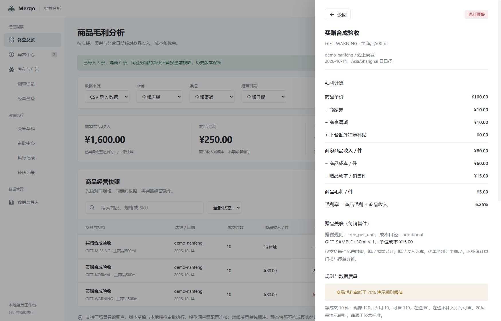

# M5 赠品：每销售件免费附赠与额外成本

后续源码更新：会员价三个样例已实现，见 [会员价契约](M5-membership-contract.md)；本文保留赠品轮次的验收数字和范围。

本轮把赠品正常、低毛利、缺成本三个固定样例接入实际导入、持久化及计算。固定业务集现在为 42 通过、0 失败、6 未支持；M5 发布门禁仍未通过。已发布的 `0.1.0-beta.1` 安装包不含本轮源码改动。

## 口径与 CSV

进入「经营分析 → 数据与导入 → 下载赠品示例」；仓库文件为 `fixtures/retail/demo-gifts.csv`。原 17 个必填字段和组合装可选字段保持兼容，新增三列：

| 字段 | 语义 |
| --- | --- |
| `gift_policy` | `free_per_unit` 表示每销售件免费附赠固定数量；`none` 明确无赠品；`unknown` 表示赠送规则待补证 |
| `gift_cost_basis` | 仅 `additional` 可计算：`cost_minor` 是不含赠品的主商品成本；`included` 或 `unknown` 均阻断，不重复扣成本 |
| `gifts` | JSON 数组，每项为赠品 `sku_id`、`spec`、`quantity`、`unit_cost_minor`；数量按每销售件计，成本为分/赠品件；未知成本填 `null`，已确认零成本填 `0` |

赠品继承主行店铺、渠道、日期和 CNY。赠品收入为零，券、满减和额外平台结算全部归主商品，不在赠品间分摊。

```text
每销售件赠品成本 = Σ(赠品数量 × 赠品单位成本)
每销售件总成本 = 主商品成本 + 每销售件赠品成本
商品毛利 = 促销后主商品收入 − 每销售件总成本
```

样例主商品收入 80 元、主成本 60 元，净成交 10 件：

| 样例 | 每销售件赠品成本 | 每销售件毛利 | 毛利率 | 状态 |
| --- | ---: | ---: | ---: | --- |
| `GIFT-NORMAL` | 明确 0 元 | 20 元 | 25% | 正常 |
| `GIFT-WARNING` | 15 元 | 5 元 | 6.25% | 毛利预警 |
| `GIFT-MISSING` | 未知 | 未知 | 未知 | 待补证 |

旧 CSV 未提供这些列时沿用原快照口径，不根据商品名猜赠品。赠品是促销关联，不改变主 SKU 的商品身份；不同日期可以有不同赠品，但复盘和 Case 必须匹配具体关联。

## 门禁与调查

- 缺规则、未知规则、缺赠品明细、成本未知、成本已计入主商品、重复赠品 SKU、同 SKU 自赠、成本越界或无赠品声明与明细冲突：保留待补证，不能输出确定毛利或提交动作审批。
- 无效 JSON、缺 SKU/规格、非正/小数数量、负数/小数成本、额外币种/收入字段或嵌套结构：隔离错误行。已识别业务列不能通过改映射或置空被静默丢弃。
- 减券测算使用主商品与赠品合计成本，保持赠送规则与数量不变。预警样例成本 75 元，即使券从 10 元减到 0，收入最多 90 元，仍达不到 20% 目标，因此条件方案明确失败。
- 集成测试另用赠品成本 10 元的可行变体：总成本 70 元，券从 10 元减到 2.5 元，收入 87.5 元、毛利 17.5 元，毛利率 20%。批准和执行只写本地模拟账本。
- 只读 SKU 工具返回冻结的赠品明细、规则、成本口径、赠品成本和总成本；数值核验拒绝替换。代码报告同时列出主成本、赠品成本及合计，避免隐去成本来源。
- 用户 CSV 仍仅分析，不能因为赠品字段完整就进入模拟执行。模型/Reviewer 协议夹具只验证工程契约，不构成真实模型质量验收。

## 复盘、Case 与恢复

观察记录必须保留赠品 SKU、规格、数量、赠送规则和成本口径；删去赠品、更换赠品或数量变化均不能当作同口径观察提交。成本变化允许保留真实输入，不承诺因果关系。

Case 检索增加赠品关联指纹，防止无赠品、不同赠品或不同数量的历史误用。子项排列顺序不影响关联身份。历史未带赠品的 Case 只匹配无赠品范围。

已复核内置合成观察经真实数据工作进程发起后续调查时，明细以 JSON 保留，Case 在创建时冻结，不产生新的批准或执行。重启持久化覆盖导入与明细；现有完整回归继续覆盖普通 SKU、组合装和审批账本。

规则升级为 `retail-margin-v3`，数据库表结构不变，旧规则与历史冻结记录保留。组合装成本仍只含包内子项，额外赠品只另加一次。

## 验证与边界

```powershell
bun run retail:check
bun run typecheck:electron
bun run retail:check:mcp
bun run retail:eval --release-gate
bun run retail:build
node scripts/merqo-gift-desktop-check.cjs
```

发布检查退出 1 为当前预期，`releaseReady: false`。桌面专项使用新隔离配置，下载样例、用实际文件预览及导入，核对三状态、赠品成本与毛利，再重启检查，不调用外部模型。

当前不处理按订单金额门槛赠送、选赠/随机赠、赠品多方承担、逐单优惠分摊、同 SKU 自赠、退货时赠品回收、嵌套组合装或赠品库存扣减。没有外部目录/平台接入，不能把静态关联解释为真实履约证明。剩余六个未支持固定样例为会员价与无货价格。

2026-10-17 实测：**197 项领域测试通过、1368 次断言**；领域及 Electron 类型检查、完整构建、三场景 MCP 回归通过。赠品桌面首次 **8 项**、重启 **7 项**检查通过；组合装兼容回归首次 **8 项**、重启 **7 项**同样通过。固定集 **42 通过、0 失败、6 未支持**，发布检查按预期退出 1。

[机器验收记录](verification/gifts-2026-10-17.json) · [逐例业务报告](verification/business-eval-gifts-2026-10-17/report.md)


