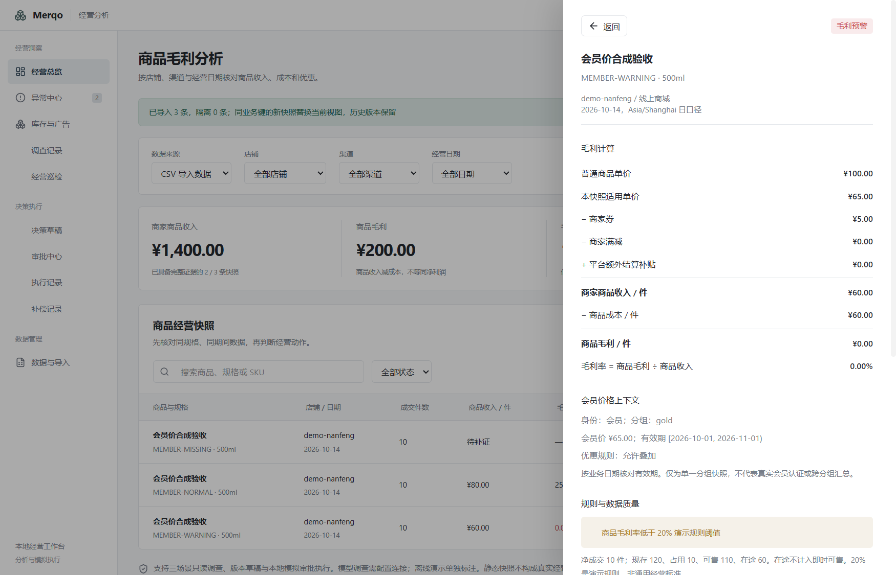

# M5 会员价：单一分组快照与优惠互斥

后续更新（2026-10-18）：无货价格三个固定样例已实现，见 [报价契约](M5-offer-contract.md)。本文保留会员价轮次的范围与验收数字。

本轮实现会员价正常、低毛利、身份未知三个固定业务样例，覆盖实际导入、确定性计算、调查核验、审批门禁及复盘。固定集为 45 通过、0 失败、3 未支持；完整 PRD 发布门禁仍未通过。本轮为源码更新，已发布 `0.1.0-beta.1` 安装包不包含这些功能。

## 数据入口与口径

「经营分析 → 数据与导入 → 下载会员价示例」，仓库样例为 `fixtures/retail/demo-membership.csv`。

新增可选 `membership` JSON 列；原 17 个必填字段、组合装与赠品字段保持兼容。一行只代表同店铺、渠道、SKU、日期的一个会员分组，`sold_qty` 必须只包含该分组。当前业务键不增加会员维度，同 SKU 同日多个分组会按既有重复键规则隔离，不混合求和；后续修正可替换当前快照，历史证据保留。

```json
{"status":"member","segment_id":"gold","price_minor":8000,"valid_from":"2026-10-01","valid_to":"2026-11-01","discount_policy":"exclusive"}
```

| 字段 | 含义 |
| --- | --- |
| `status` | `member`、`non_member` 或 `unknown`；按导入来源声明，不证明真实客户身份认证 |
| `segment_id` | 会员等级/分组标识，会员计价必需；不保存个人身份信息 |
| `price_minor` | 分/销售件，会员价替代普通标价，不再作为折扣扣第二次 |
| `valid_from` / `valid_to` | Asia/Shanghai 业务日期，左闭右开 `[from,to)`；用行内经营日期判断，不用今天替代历史日期 |
| `discount_policy` | `stackable` 允许再扣券和满减；`exclusive` 与二者互斥；`unknown` 待补证 |

明确非会员使用普通价，不享用所附会员报价；旧 CSV 未提供此列时沿用原普通价口径。明确 JSON `null` 是未知上下文，阻断会员计价，不能变成空列后按普通价回退。后续观察转 CSV 的公共序列化保留这一差异。

## 确定性计算与门禁

会员状态、分组、价格、有效期和叠加规则齐全后：

```text
适用单价 = 会员价（会员）或普通价（明确非会员/旧普通价快照）
商品收入 = 适用单价 − 券 − 满减 + 已确认额外平台结算
商品毛利 = 商品收入 − 主商品/组合包成本 − 额外赠品成本
```

| 样例 | 适用价 | 券 | 成本 | 商品收入 | 毛利率 | 状态 |
| --- | ---: | ---: | ---: | ---: | ---: | --- |
| `MEMBER-NORMAL` | 80 元 | 0 元 | 60 元 | 80 元 | 25% | 正常 |
| `MEMBER-WARNING` | 65 元 | 5 元（可叠） | 60 元 | 60 元 | 0% | 预警 |
| `MEMBER-MISSING` | 身份未知 | 0 元 | 60 元 | 未知 | 未知 | 待补证 |

身份未知、缺分组/价格/有效期/叠加规则、价格不适用于业务日期、会员价高于普通价、互斥规则同时有券/满减、优惠超过会员价：保留待补证，不生成确定毛利，不自动选一个优惠或回退普通价。

无效 JSON、非正/小数价格、错误状态/规则类型、不存在的日期、额外币种或未知 JSON 字段隔离。已识别的会员列不能通过清空映射被静默忽略。

减券测算在会员身份、适用价格和叠加规则不变条件下进行：协议测试使用会员价 80 元、券 10 元、成本 60 元的可叠变体，券改为 5 元后收入 75 元、毛利 15 元、毛利率 20%。这不预测销量，也不证明真实平台允许该动作。

## 冻结证据、审批、Case

优惠只读工具返回冻结的会员 JSON、适用单价和范围说明。数值核验拒绝篡改身份、价格、规则或适用单价；报告单独展示普通价与适用价。组合包与赠品成本仍各计一次。

未知身份、过期或互斥冲突的报告不能进入审批，Reviewer 协议夹具的 passed 也不能越过硬门禁。审批后修改分组等证据，使旧授权在产生模拟副作用前失效。用户 CSV 继续仅分析；可执行闭环测试只使用本地合成数据与协议夹具，不算真实模型质量证据。

复盘保持分组、身份和优惠叠加规则相同；价格、有效期可在同一分组内变化，但新的业务日期必须仍满足计算契约，不能把过期报价解释为有效结果。Case 检索绑定分组/身份/叠加规则，避免其他分组或历史普通价案例误用。已复核的内置观察经真实工作进程发起后续离线调查时保留会员上下文、冻结 Case，并且不产生新的执行。

规则版本为 `retail-margin-v4`，保留旧规则与冻结记录，不改 SQLite 表结构。当前快照重算后旧决策需按既有版本/证据校验，不能继承旧批准绕过本轮约束。

## 验证入口与边界

```powershell
bun run retail:check
bun run typecheck:electron
bun run retail:check:mcp
bun run retail:eval --release-gate
bun run retail:build
node scripts/merqo-member-desktop-check.cjs
```

发布检查预期退出 1，仍为 `releaseReady: false`。桌面专项隔离用户配置，下载示例、导入真实文件、核对三状态/价格/分组/规则及重启持久化，不调用外部模型。

不支持实时会员认证、会员费用分摊、跨分组收入汇总、同日多价格/多身份成交混算、逐单最优优惠选择、订单门槛或分钟级价格生效；这些数据须先由可信来源整理为同口径快照。剩余三个未支持固定业务样例为无货价格，真实模型质量、性能和完整发布门禁仍待完成。

2026-10-17 实测：领域 **204 项通过、1485 次断言**，领域与 Electron 类型检查、完整构建及三场景 MCP 回归通过。会员价桌面首次 **8 项**、重启 **7 项**检查通过；赠品、组合装兼容回归各 **8+7 项**通过。固定集 **45 通过、0 失败、3 未支持**，发布检查按预期退出 1。工程测试使用协议夹具，不新增真实模型质量证明。

[机器验收记录](verification/membership-2026-10-17.json) · [逐例业务报告](verification/business-eval-membership-2026-10-17/report.md)


