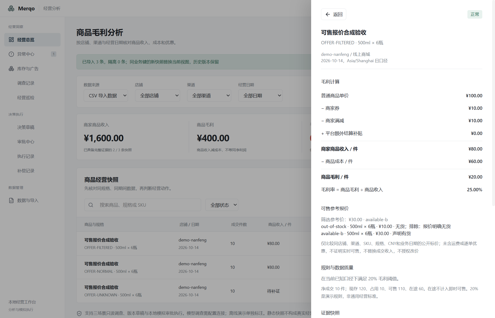

# M5 无货价格与同口径可售报价筛选

本轮完成最后三个固定业务样例：明确可售、排除无货低价后选择可售报价、可售状态未知。固定集达到 **48 通过、0 失败、0 未支持**。完整 PRD 发布门禁仍未通过；真实模型质量、性能等门禁须独立验收。已发布的 `0.1.0-beta.1` 安装包不包含本轮源码更新。

## 导入契约

入口：「经营分析 → 数据与导入 → 下载可售报价示例」。源码样例为 `fixtures/retail/demo-offers.csv`。

新增可选 `offers` JSON 数组列，最多 100 项。旧 CSV 未提供时沿用原流程；明确 `null`、空数组或无可用报价时保留待补证。公共快照 CSV 序列化保留 JSON `null`，不会静默变成未提供。

| 字段 | 规则 |
| --- | --- |
| `offer_id` | 非空唯一报价标识；重复 ID 阻断选择 |
| `shop_id` / `channel` / `sku_id` / `spec` / `currency` | 逐项精确匹配父快照；币种当前仅 CNY；无模糊 SKU 或规格匹配 |
| `observed_on` | 合法业务日期，须与父快照日期相同 |
| `audience` | `public` 可比较；`member` 排除；`unknown` 待补证 |
| `price_minor` | 正整数分/同 SKU 规格的销售件，最高 100,000,000 分；按声明的公开标价比较 |
| `available` | `true` 明确可售；`false` 明确无货；`null` 未知，不能猜成 false 或 true |

范围/日期不匹配、明确无货或会员专属报价保留排除原因。匹配范围的报价若可售状态或人群未知，保留待补证，即使另有已知可售报价也不确认最低价。所有报价都排除时也待补证。价格相同按报价 ID 字典序选择，输入顺序不影响结果。

无效 JSON、缺身份字段、非正/小数/越界金额、错误布尔值、非法日期、额外币种或未知字段隔离错误行；已识别报价列不能通过置空映射静默删除。

## 结果与成交口径

`selectOffers` 返回规则版本、选择状态、所选 ID/价格、候选 ID、排除原因、缺口及限制；字段齐全不等于来源真实。仅在已提供的同口径报价集合中比较，不覆盖未提供的其他市场报价。

| 样例 | 声明报价 | 选择结果 |
| --- | --- | --- |
| `OFFER-NORMAL` | 10 元，有货 | 10 元 |
| `OFFER-FILTERED` | 10 元无货；30 元有货 | 排除 10 元，选择 30 元 |
| `OFFER-UNKNOWN` | 10 元，可售未知 | 待补证，无确定选择 |

所选参考价与成交价分开保存和展示。样例普通单价 100 元、券与满减各 10 元，商品收入仍为每销售件 80 元、成本 60 元、毛利 20 元。选择 10 元或 30 元参考价都不改写这一成交口径，也不触发改价。

显式附带报价且选择证据不完整时，本版整体将该快照标为待补证，不计入完整证据汇总；原始成交字段保留。来源修正后创建新快照，历史冻结证据不改变。

## 调查、审批与复盘

只读优惠工具返回完整冻结报价及确定性筛选结果。数值核验拒绝改写报价范围、库存声明或选择价格。代码报告将参考报价单独标注为“非成交价”，并保留未含运费、逐单优惠和实时库存验证的限制。

报价未知、无可售候选或身份不匹配时不能提交动作审批，Reviewer 协议 passed 不能越过硬规则。已有批准后的报价可售状态改变，使旧授权失效。CSV 继续只分析；模拟执行测试依旧只批准原成交券参数，不能通过参考报价授予实际改价权限。

复盘不允许静默移除报价上下文；新报价仍须与观察窗口的业务日期和范围一致。报价 ID、价格、可售状态可在明确观察记录中变化，比较结论只确认输入前后变化。

内置合成回放将原本同日的报价观测日期随回放窗口平移，价格和可售声明保持原值；原本过期的报价不会被提升为有效报价。这是显式合成观察，不是重新抓取的实盘报价。

Case 检索增加公开报价上下文范围约束；已复核内置观察经实际数据工作进程发起后续调查时保留报价、日期和冻结 Case，执行账本不增加副作用。规则升级为 `retail-margin-v5`，表结构不变，旧规则、批准及冻结记录继续保留。

## 验证入口

```powershell
bun run retail:check
bun run typecheck:electron
bun run retail:check:mcp
bun run retail:eval --release-gate
bun run retail:build
node scripts/merqo-offer-desktop-check.cjs
```

发布检查仍应退出 1，`releaseReady: false`。报价三个样例独立记录为选择契约的 accepted / needs_evidence，不混入毛利、库存和广告检测的正常/预警混淆矩阵。工程测试使用合成数据与本地模型协议夹具，不调用外部模型。

## 范围与后续

当前仅处理明确提供的同店铺、同渠道、同 SKU/规格、同日的公开报价。没有跨平台目录匹配、实时库存查询、抓价 Adapter、运费/券后落地价、会员最优价或竞品全网最低价保证。`available` 是来源声明，不证明已经校验真实库存。旧 SKU 匹配、异常销量和延迟事件样例也仍有窄范围限制。

下一阶段转入 M5 的完整门禁：三主场景各五次真实模型调查及禁止动作检查、10 万行/30 次查询 p95 与分页、调查暂停恢复及 AgentBackend 复用、Windows 跨版本升级和干净环境兼容性，再准备包含新源码的安装包。

2026-10-18 实测：领域 **211 项通过、1578 次断言**；领域及 Electron 类型检查、完整构建、三场景 MCP 回归通过。报价桌面首次 **8 项**、重启 **7 项**通过；会员价、赠品、组合装兼容回归各 **8+7 项**通过。固定集 **48 通过、0 失败、0 未支持**；发布门禁预期退出 1。真实模型评测尚未在本轮执行。

[机器验收记录](verification/offers-2026-10-18.json) · [逐例固定集报告](verification/business-eval-offers-2026-10-18/report.md)


