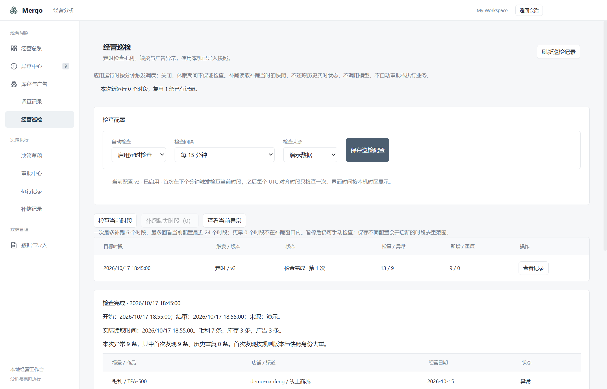

# P0 经营巡检、补跑与去重

经营分析的“经营洞察”新增经营巡检，沿用浅灰背景、白色分块、细分隔线与现有字体。配置、运行列表、冻结结果分块显示。

主进程复用 Craft 的 SchedulerService（分钟对齐）扫描本机已创建巡检数据库的工作空间，跳过远程空间；通过隔离 Bun 工作进程调用内部 check_tick，渲染端不可调用该操作或提供工作空间、时钟、角色。调度器在应用 ready 后启动、before-quit 停止。不依赖经营分析页面保持打开。

默认关闭；可选演示或CSV来源及15分钟/1小时/24小时周期。时段按UTC边界对齐（每日为北京时间08:00），界面按本机时区显示。首次在下个分钟tick检查当前时段。保存不同配置增加版本并从当前时段生效，同配置无变化保存不增加版本；暂停不会取消已开始的只读任务。

每个工作空间有独立 operations.sqlite.checks.sqlite。配置带版本比较；运行以配置版本+时段唯一，SQLite immediate事务认领。运行先持久化running，两分钟过期转interrupted；显式重试保留旧尝试、最多三次。过期执行者不能覆盖新尝试。结果、首次发现索引和成功状态在同一事务提交。异常首次发现按工作空间、场景、来源、业务字段内容、规则及派生结果（忽略导入批次ID）去重，不代表外部消息已经发送。

启动不自动补历史时段。手动补跑最多回看最近24个时段、每次最多6个，失败项单独重试。目标时段和实际观察时间同时保留；所有补跑读取当时最新本地快照，不伪造历史实时观测。更早的时段显式提示已超出补跑范围，不声称补齐所有离线时间。时钟回退到配置之前拒绝运行。

检查覆盖毛利/库存/广告的确定性异常与待补证状态。没有某类来源数据时记录缺口；过期CSV标注历史检查，演示数据不受24小时导入时效限制。运行记录最多展示最近30条，单次异常预览最多200条，合计仍覆盖全部记录；历史结果冻结保留。空数据的“检查完成”不表示经营正常。

本轮仅做定时规则扫描，不调用模型、不创建调查/草稿/审批/执行，不保证应用退出、休眠或机器关闭期间持续运行。需调查时通过“查看当前异常”选择最新记录，历史巡检不直接授权操作。M5的48例业务评测、10万行性能与安装包验收仍待完成。

验收：经营分析→经营巡检→保存启用配置，等待下个分钟tick；记录应出现定时触发。重复检查当前时段不增加同版本同槽记录。离线缺口可有限补跑，重启后配置、结果与错误历史保留。

源数据打开被延迟到认领任务之后；即使源SQLite损坏，也能在独立巡检库中保存失败并刷新查看。巡检库版本为1，未知更高版本拒绝打开。running租约恢复使用status/started_at索引，避免反复扫描全部历史。

## 验证结果

182项领域测试（960次断言）、领域及Electron类型检查、完整构建通过；新增恢复索引后12项巡检专项（61次断言）通过。SQLite执行计划确认running恢复查询使用check_active索引。

完整桌面首轮56项、重启16项通过；经营巡检专项7项、再次重启5项通过。专项实际等待SchedulerService的下一分钟回调（2026-10-17 18:55北京时间），确认三场景完成、同槽去重、渲染端禁止内部tick、没有增加审批或执行，暂停与结果重启保留。完整桌面模型响应来自本地协议夹具，不能作为新增真实模型质量证据。

主进程新增一个应用级SchedulerService实例，复用基座的分钟对齐与防重入实现；不写入通用自动化页面的用户任务，入口为经营分析中的经营巡检。

[机器验证记录](verification/scheduled-checks-2026-10-17.json)

