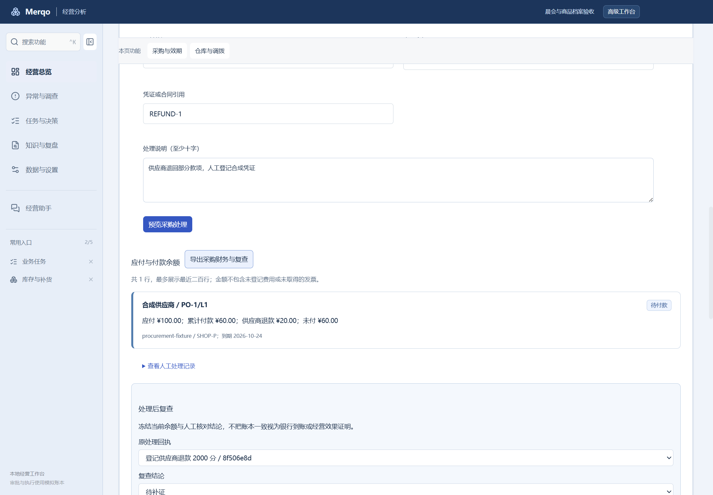
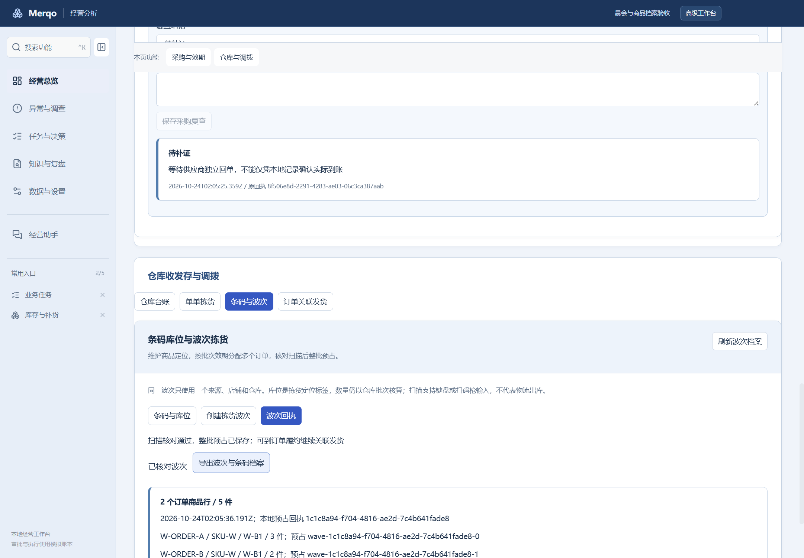
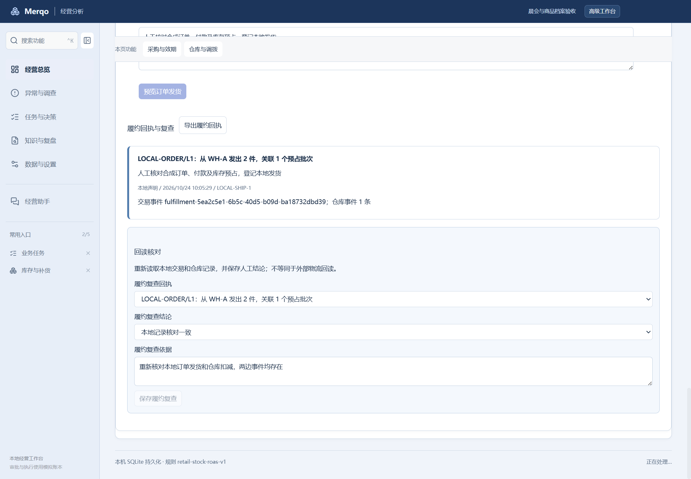
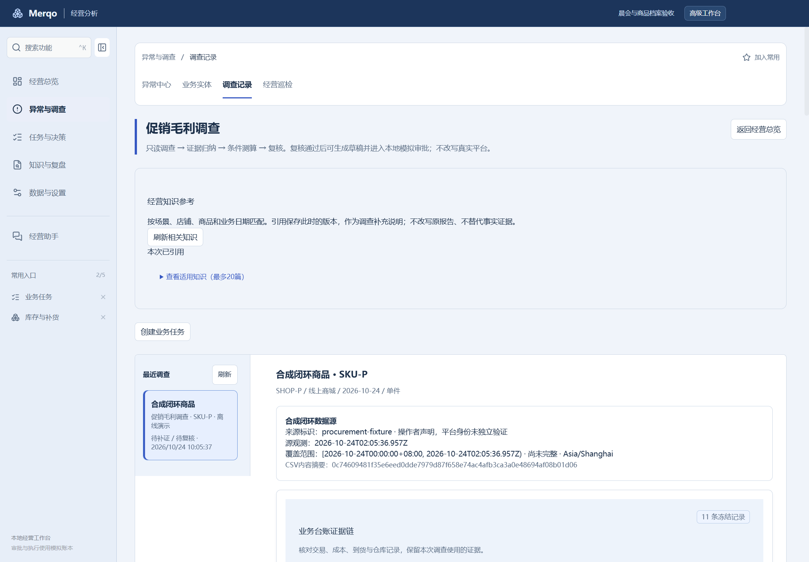

# 本地业务闭环开发与验收记录

日期：2026-10-24。用户确认暂无现成外部系统，先完成本地业务闭环；抖店、安卓暂缓。

路线：台账接入 → 联合调查 → 财务和入库处理 → 条码波次 → 关联发货 → 回执复查 → 任务 → 经营案例。

## 本轮完成

| 环节 | 软件入口及行为 |
| --- | --- |
| 证据接入 | 调查创建或补证时冻结同范围交易、成本、采购、仓库和采购财务台账；导出保留引用与缺口 |
| 采购财务 | 库存与补货 → 财务与入库处理：登记应付、人工付款、供应商退款，显示余额、逾期、凭证及复查历史 |
| 到货审核 | 单独预览和确认合格可售与隔离数量，到货不自动全部成为可售库存 |
| 条码波次 | 库存与补货 → 条码与波次：维护条码和库位定位，2—20条订单需求按先到期先出分配，实扫正确后统一预留 |
| 关联发货 | 库存与补货 → 订单关联发货：明确匹配已付款订单行与预留批次，一次确认同时写交易发货与仓库扣减 |
| 回读复查 | 保留财务及关联发货的本地回读结果、依据、异常或待补证状态 |
| 任务与案例 | 调查任务及归档案例保留同一冻结证据索引，不重复复制原始台账 |
| 界面组织 | 采购和仓库采用分组页签，记录以卡片、边界、状态和折叠详情呈现 |

## 业务约束

- 明确匹配来源、店铺、渠道、SKU、规格与窗口，不按商品名称推断身份。采购、仓库、财务缺渠道时只作旁证。
- 每类调查证据最多30条，披露缺证和截断；合成快照不混入操作者仓库记录，历史调查保持冻结。
- 预览不写业务账。确认检查版本、状态、日期和有效期，使用事务及幂等回执；失败不留下半笔发货或半个波次。
- 实扫逐订单匹配数量、条码和库位标签。库位为定位标签，库存仍按仓库与批次核算。
- 付款和退款为操作者本地声明，未连接银行；本地发货不证明物流签收；审批仍为本地模拟。

## 验收证据

- 完整领域回归：425项测试、3833次断言通过，62个文件；领域类型检查通过。
- 增加查询索引后，4个新增领域文件再次通过11项测试、74次断言。
- Electron与领域类型检查通过，主进程和渲染进程构建通过。
- 实际Electron隔离合成工作区8组验收通过：财务余额、复查与原生导出、审核入库、关联发货、多订单波次及错误扫码、调查冻结及导出、任务案例引用、1440/800布局与真实重启保留。
- [桌面验收结果](verification/local-business-2026-10-24/desktop-result.json)。验收不读写个人正常工作区。
- 49000条合成仓库事件、20行波次：查询计划确认使用范围索引，证据读取约3.2—3.6ms、波次预览约630ms。[测量结果](verification/local-business-2026-10-24/performance-result.json)。这是本机合成测量，不代表并发能力、冷启动或生产延迟承诺。

## 交付状态与剩余范围

beta.13已完成33组打包业务流程及4组NSIS生命周期验收，完整领域回归425项通过。详见[发布验收记录](release-beta13-2026-10-24.md)。

仍需独立设计或外部条件：真实平台写回与回读、银行和物流凭证、独立身份多人审批、干净Windows及跨版本验证；更细的部分换货与跨行信用额结转也尚未实现。本轮不将这些列为已完成。
