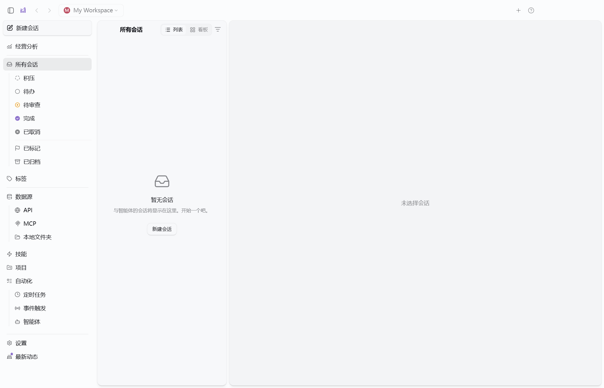

# 独立经营分析窗口

日期：2026-10-17。

主窗口保留“经营分析”入口。点击后在同一应用内创建独立桌面窗口，主窗口保持原会话与导航。每个本机 workspace 同时只保留一个经营窗口；重复进入聚焦并恢复该窗口，不重置页面、不新建业务数据库。“会话窗口”回到对应 workspace 的普通窗口；普通窗口已关闭时重新创建。

## 界面

- 白色内容面 `#ffffff`、浅灰页面 `#f6f7f9`、深灰文字 `#24282f`、灰色辅助文字 `#737b87`、细分隔线 `#e4e7eb`、蓝灰操作色 `#4b5e70`。
- 使用 Segoe UI / Microsoft YaHei UI，标题、分组和辅助信息分级；数字保持等宽。无渐变背景、无装饰插画、无大面积阴影。
- 顶部只有产品名、经营分析、workspace 名称、会话窗口入口及原生窗口控制。
- 左侧分为经营洞察、决策执行、数据管理。移除通用会话、API、MCP、技能等侧栏和密集横向标签。
- 筛选、指标、表格用独立白色区域分隔；调查、草稿、审批等保留记录列表与详情两栏，报告章节用分隔线及留白组织。
- 独立经营窗口固定为简洁浅色，不改变主窗口的主题偏好。

## 窗口与数据边界

通过类型化的 `retailWindow('open' | 'agent')` 预加载接口请求主进程。工作空间从已注册顶层 webContents 推导，拒绝子页面、未知动作、对象/路径和额外范围参数。前端不能指定另一个 workspace。沿用原 Electron contextIsolation、禁止 renderer Node 的边界，不新增通用窗口/任意 URL 打开能力。

窗口角色由主进程登记，URL 中的 surface 只用于选择渲染界面。保存和恢复时保留经营角色与实际 workspace；重复恢复不产生同空间的多个经营窗口。关闭经营窗口不关闭会话窗口；重开读取同一 SQLite 历史。未保存的表单输入不承诺跨关闭保留。

调查、草稿、审批、执行、补偿、复盘与 Case 规则不变。本次不新增真实业务写入，不改变 Reviewer 待补证或驳回状态。

## 手动验收

1. 主界面点击“经营分析”，确认出现单独窗口，原主界面仍可用。
2. 分别进入三组导航，确认筛选、表格和详情清楚，横向长标签及聊天侧栏已移除。
3. 在“调查记录”停留，切回主窗口再次点入口，应回到同一窗口和页面。
4. 关闭经营窗口再打开，应继续使用原来的导入数据、草稿与历史。
5. 使用右上角最小化、最大化和关闭；点击“会话窗口”应回到原工作空间。
6. 重启应用后检查窗口角色和历史；原有三场景调查、审批、执行及复盘链路仍可操作。

验证结果见 `verification/retail-window-2026-10-17.json`。截图与自动化使用隔离的合成数据空间，不修改用户经营记录。

## 验证记录

全项目类型检查、最终 Electron 类型检查、完整构建与最终 renderer 构建通过。传输契约 2 项、1244 次断言通过。原生完整首轮 57 项、同配置重启 18 项通过；正常退出保存 6 项、冷启动恢复 8 项通过。恢复阶段在点击主入口之前已观察到独立经营窗口，再核对一次单例及同空间数据。

最初的新窗口重复显示连接欢迎页，已修复为无需配置模型即可进入本机分析；模型调查仍受原连接校验。一轮运行日志出现约 36 分钟间隔并超时，未计通过，随后同流程完整重跑通过。业务模型输出仍由本地协议 fixture 驱动，不作为真实模型质量评测。

