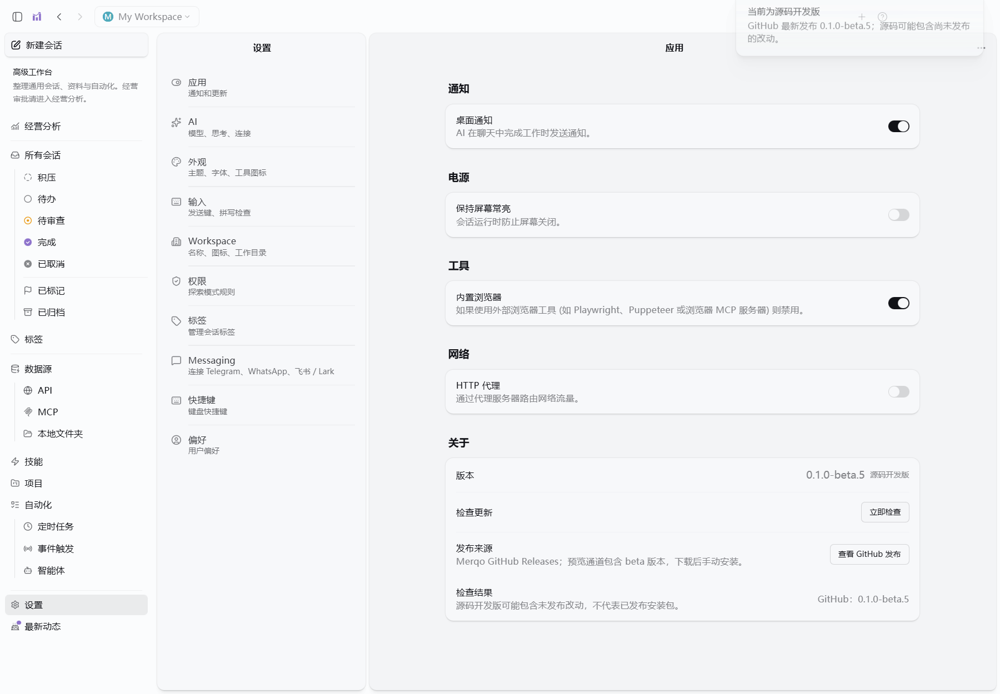
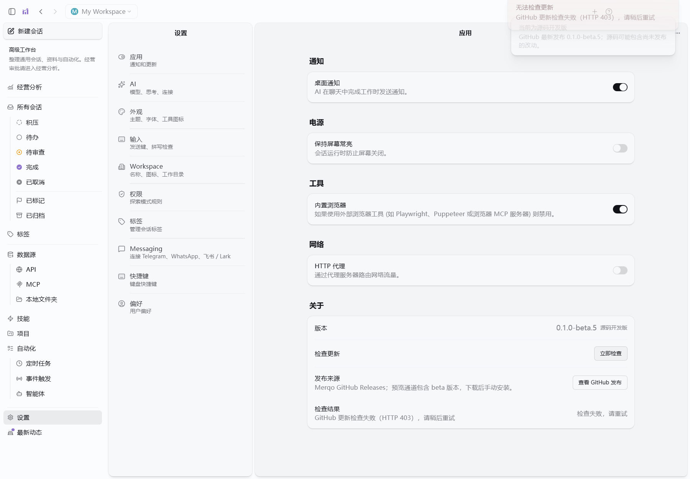

# 版本号与 GitHub 更新检查修复

日期：2026-10-21。

## 问题与原因

关于页显示继承自 Craft Agents 的 `0.11.4`，Windows 打包配置却使用 Merqo 的 `0.1.0-beta.5`。运行时版本此前来自 `packages/shared/package.json`，两份来源没有统一。

此外，原更新检查始终返回「RetailPilot 更新服务尚未配置」，同时 `available=false`；界面未先检查 `error`，可能错误提示「已是最新」。原逻辑没有读取 RXQ6/Merqo 的发布记录。

## 修复后的行为

- `packaging/windows-release.json` 为 Merqo 发布版本来源；源码运行时和 root/electron/shared 包版本统一。安装版读取 Electron 的实际包版本。
- 关于页明确标注「源码开发版」，并单独显示 GitHub 发布版本。源码包含未发布改动时，不将版本号相同解释为安装包内容相同。
- 只读取 `https://api.github.com/repos/RXQ6/Merqo/releases?per_page=100`。预览通道包含 prerelease；不依赖会跳过 beta 的 `/releases/latest`。
- 按语义版本排序，排除草稿、无匹配 Windows x64 安装包、错误来源的资产和无效标签。稳定通道排除预发布版本。
- 网络失败、HTTP 错误、无可用包或格式异常显示检查失败，不显示最新版本；失败会清除上次成功的最新版本，成功重试会清除旧错误。
- 现有发布没有自动升级所需的 YAML 等元数据，因此采用「检查 → 查看 GitHub 发布 → 手动下载安装」。不自动下载或执行安装器，也不连接上游 Craft Agents 更新源。

## 验收证据

- GitHub API 实际读取：仓库发布列表包含 beta.1、beta.2、beta.3、beta.5，均为预发布；修复后的 `fetchMerqoRelease('0.1.0-beta.5')` 实际网络请求返回 `0.1.0-beta.5` 和对应 RXQ6/Merqo 发布页。
- `bun test apps/electron/src/main/merqo-releases.test.ts`：8 pass，0 fail，17 assertions；覆盖统一版本、预发布排序、稳定通道、错误资产、无发布、语义版本和 HTTP/网络失败。
- Electron 类型检查、main 和 renderer 构建通过；renderer 保留既有大 chunk 提示。
- `scripts/merqo-update-ui-check.cjs`：真实 Electron、renderer、preload、main RPC。仅测试进程中的 GitHub HTTP 被替换；验证同版本 beta 的开发版展示、HTTP 403 错误、合成未来版本提示以及重试恢复。没有真实下载或安装。
- 最终原始桌面证据：`artifacts/update-ui/2026-10-21T13-05-03-886Z/`；可跟踪记录见 [验收结果](verification/update-check-2026-10-21/result.json)。

早期桌面测试曾因残留隔离实例占用和等待窗口载入过早失败。清理已核实的隔离测试进程、修正等待条件后通过；没有结束用户的普通工作实例。

## 发布边界

本次修复提交源码，不修改或覆盖 GitHub 上现有的 beta.5 安装包，也不声称已发布新版本。已经运行的旧进程需要重新启动修正后的源码构建；旧安装包只有在升级到未来包含修复的新安装包后才会采用这套逻辑。本轮未执行打包安装、跨 Windows 或干净环境验收。
