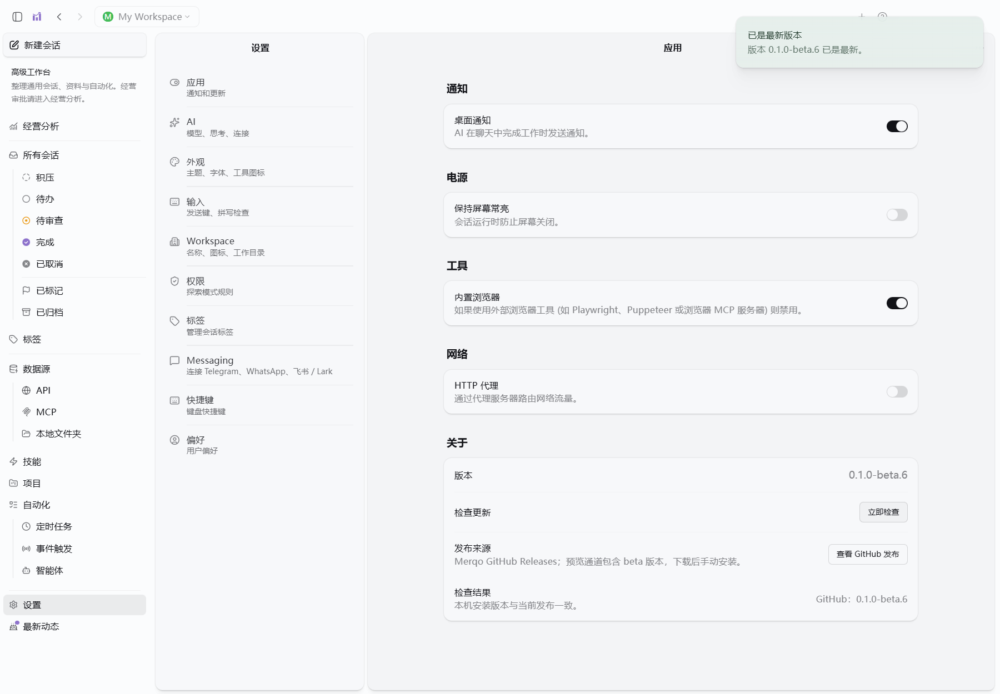

# beta.6 Windows 本机安装验收

日期：2026-10-21。Windows 11，本机隔离目录，实际 NSIS 安装包。

371项业务测试、3362个断言通过；更新检查8项测试通过；Electron类型检查、完整主进程/preload/renderer/resources构建通过。

实际安装验收共30项通过，包括内置Bun、无开发环境PATH、三场景MCP与协议、模拟审批执行、暂停后重启恢复、分页、交易扩展、DeepSeek动态模型、实际安装版版本与GitHub检查、同版本重装保留数据、卸载保留配置。GitHub错误与未来版本使用隔离HTTP夹具；不是新的真实平台或模型质量验收。

完整结果：[安装验收](installer-lifecycle.json)、[更新检查](update-installed.json)、[构建来源](build-inputs.json)、[SHA-256](SHA256SUMS.txt)。安装包构建源提交ecd8e9a2cf342ae68d5d9e818b65f8dfa2f16a06，sourceDirty=false。后续脚本提交仅修正了验收按钮名称。

首次安装验收因旧脚本仍查找返回会话失败，改为高级工作台后重跑通过；安装包没有为此重新构建。

限制：未签名；未验收干净Windows虚拟机、跨Windows版本和跨版本NSIS升级；本次隔离安装不改写用户原有工作配置。更新采用查看GitHub发布并手动下载安装。
