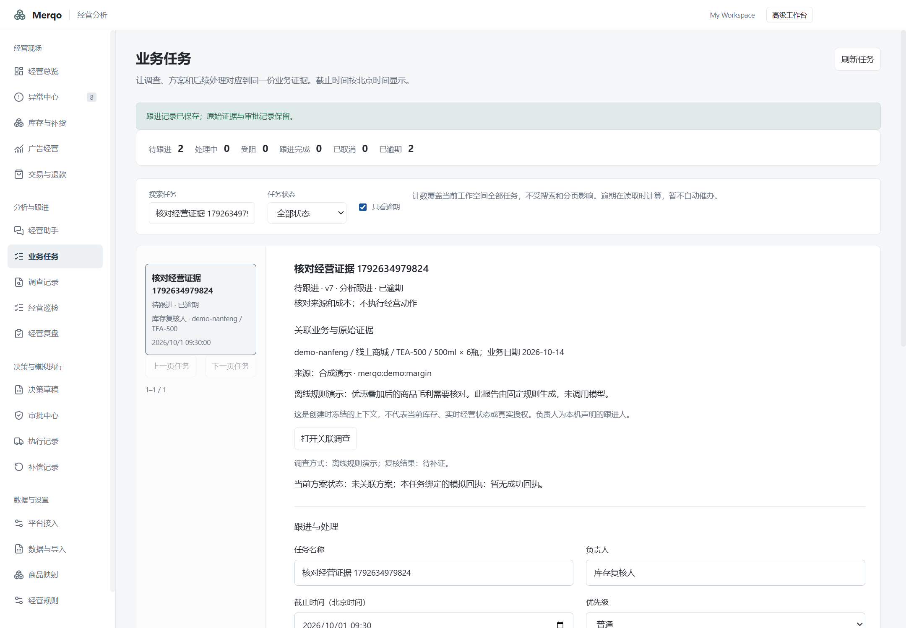
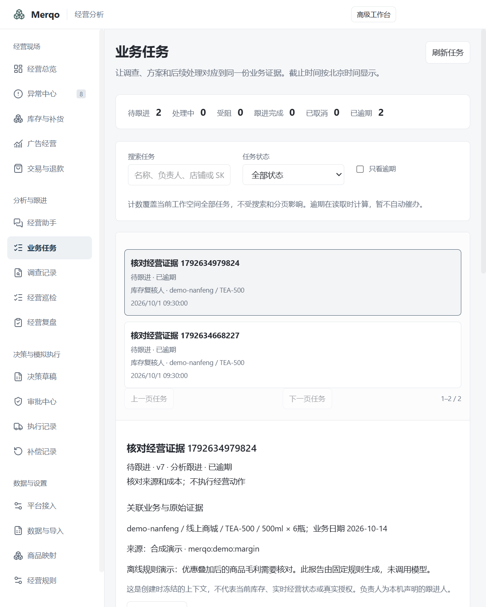

# 业务任务桌面验收

2026-10-22，Windows 11本机，隔离合成配置。真实Electron、preload、IPC和Bun worker；无真实平台调用。

- 全量领域测试380通过、0失败、3415断言。
- Electron/领域TypeScript及main/renderer构建通过；renderer保留既有大chunk提示。
- 从离线调查创建任务，冻结原调查ID、商品范围及报告摘要。北京时间输入09:30，数据库保存对应UTC01:30。
- 修改负责人、开始处理、受阻、追加记录、完成、重新打开，共7个版本；完成后字段锁定，重开需说明。
- 逾期搜索、全范围计数、原调查跳转及重复创建保持原ID和版本。
- 1440px两列与800px单列实测；任务主内容没有横向溢出。截图等候列表读取完成，避免截取修改后的短暂旧列表。
- 实际退出并重启Electron，原负责人、截止日期、状态、冻结证据与7条历史记录保留。
- 从保存方案创建任务，绑定准确方案ID/版本；返回原方案后选中对应草稿。模拟回执完成门槛、旧版方案、版本冲突和跨工作空间拒绝由领域测试覆盖。

脚本：[merqo-business-tasks-check.cjs](../../../scripts/merqo-business-tasks-check.cjs)。机器可读结果：[result.json](result.json)。原始trace和失败排查保留于本机忽略目录：artifacts\business-tasks\2026-10-22T02-09-27-353Z。

首次脚本缺少模块路径、遗漏首次启动跳过流程，且隔离配置原无调查、错误选择普通样例，均已修正；未将这些失败计为通过。最终使用明确的TEA-500预警样例，并等待界面与列表加载完成。

本轮未发布新安装包；业务任务属于开发源码。没有验证真实模型、真实平台、多人身份、自动通知、干净Windows或跨Windows版本。完整范围见[交付说明](../../P2-business-tasks-2026-10-22.md)。
