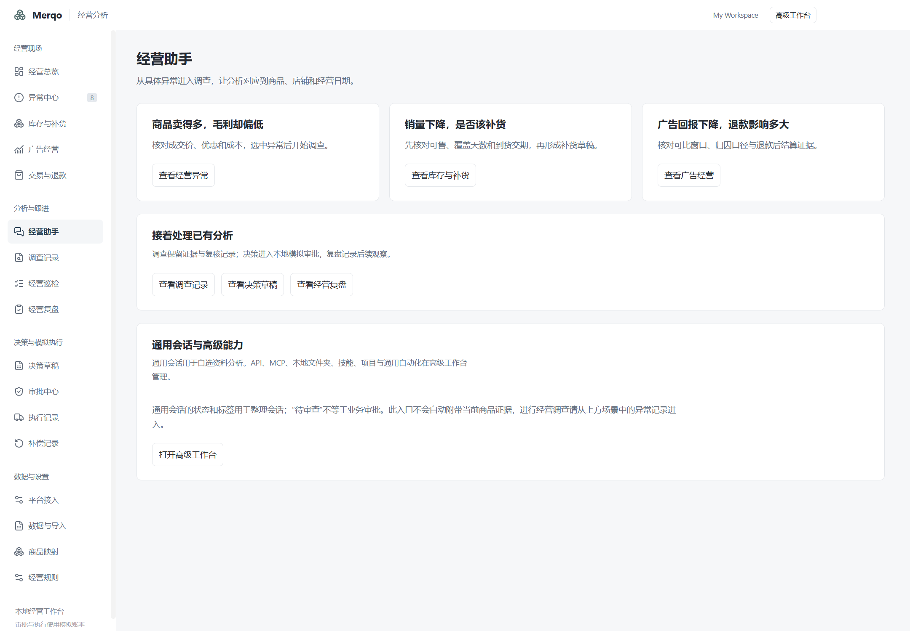
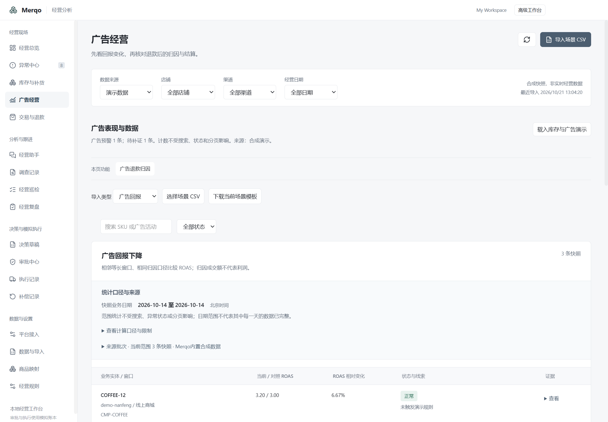
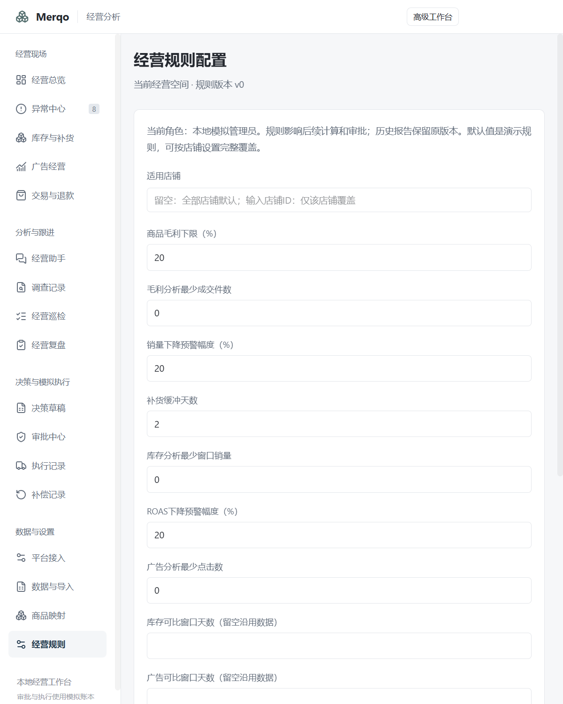

# 经营工作台导航与排版验收

日期：2026-10-21。Windows 11 本机，真实 Electron 窗口；只使用隔离合成配置。

- Electron TypeScript 检查通过。
- Renderer 构建通过，保留既有的大 chunk 提示。主进程、preload、domain 和数据库契约未修改。
- 18 个经营页面 × 1440/800 两种宽度，共 36 次检查：数据加载完成后一级标题唯一、22px、左对齐一致，主内容无横向溢出。
- 库存与广告分离：各自表格、导入类型、经营模块与质量批次过滤正确；异常中心继续并列呈现异常。
- 8 次页内功能定位、助手场景入口、通用高级工作台往返正常。
- 从经营总览选择 CSV 后进入导入预览正常；未确认入库。
- 两类各 65 条合成记录：分页30/30/5、末页精确场景导出、搜索、状态筛选、完整范围计数、页外店铺、刷新和异常中心通过。
- 验收前后原隔离配置的交易事件数量和合计不变；无模型或真实平台请求。

原始截图与 trace（本机忽略目录）：

- artifacts/business-layout/2026-10-21T12-04-14-644Z
- artifacts/signal-pagination/2026-10-21T12-04-14-118Z

可跟踪结果：[页面检查](layout-result.json)、[分页检查](pagination-result.json)。

## 界面证据

## 修复与范围

首轮脚本误用了「促销资格」按钮名，实际为「促销与赠品」；修正后完成最终验收。首次截图等候条件不充分，最终脚本已等待读取与处理提示结束再截图。检查时修复整块内容重挂载可能打断文件选择的问题，仅独立场景组件按页面重挂载。

本批未重跑上一批的371项domain测试；没有修改相关计算。通用会话状态与用户标签未迁移，业务任务系统和实体上下文会话仍是后续工作。未验证真实平台、干净Windows环境或跨Windows版本，也未发布新安装包。
