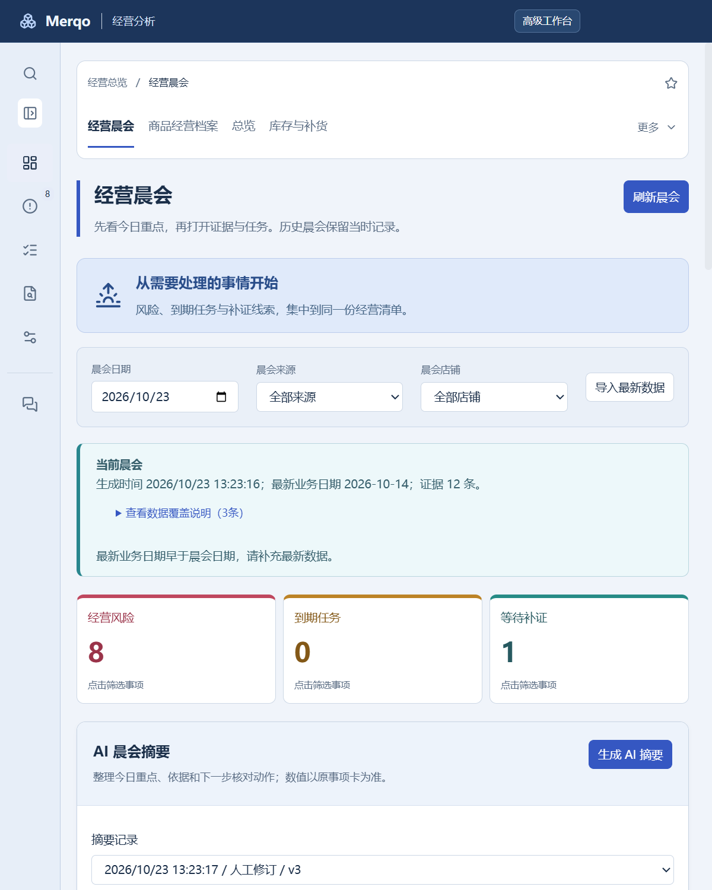

# beta.12 打包验收报告

日期：2026-10-23。Windows11 build26200，独立合成工作区；模型回答通过本地接口协议夹具验证。

| 验收范围 | 通过结果 | 证据 |
| --- | --- | --- |
| 领域回归与类型检查 | 414项、3759次断言、零失败 | `bun run retail:check` |
| AI摘要、分类、调序 | 5组 | [打包结果](packaged-enhancement-result.json) |
| 晨会、商品时间线、冻结案例、响应布局 | 8组 | [打包结果](packaged-experience-result.json) |
| Wiki W1—W3 | 8组 | [打包结果](packaged-wiki-result.json) |
| 原有实体、任务、复查、案例链路 | 4组 | [打包结果](packaged-three-batches-result.json) |
| 模型遥测、工具边界、翻译覆盖、分页回归 | 12项、113次断言 | `beta12-boundary.log` |
| MCP stdio 与冻结证据边界 | 完整脚本通过 | `bun run retail:check:mcp` |
| GitHub CI | 通过 | [应用提交检查](https://github.com/RXQ6/Merqo/actions/runs/39905364843/job/120255970973) |

25组打包界面验收包括：冻结晨会模型输入不含原始记录、无工具调用；无效数值回答拒绝落为成功；摘要原稿/人工修订/原事项引用/TXT下载；品类标签和异常匹配解释；反馈开关、分类变化后的陈旧反馈排除；停用案例只维护不推荐；案例分类冻结到调查导出与任务，后续分类修订不改写历史任务；1440px/800px布局和进程重启保留。

截图：

本报告没有将模型协议夹具等同于真实模型的业务质量验收，也没有将当前主机安装测试等同于干净系统、跨 Windows 兼容性或签名验收。真实抖店授权、安卓和真实平台写回不在本次交付范围。
