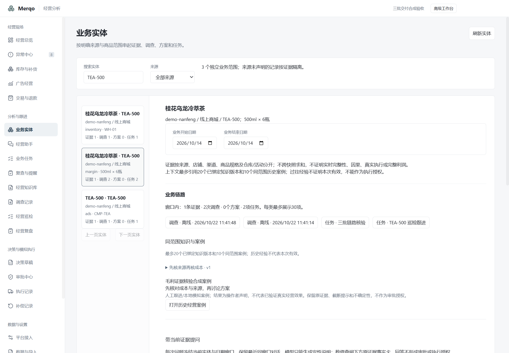
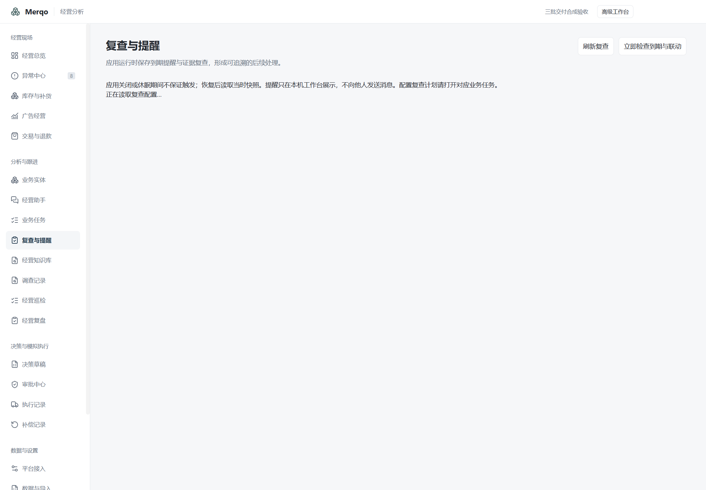
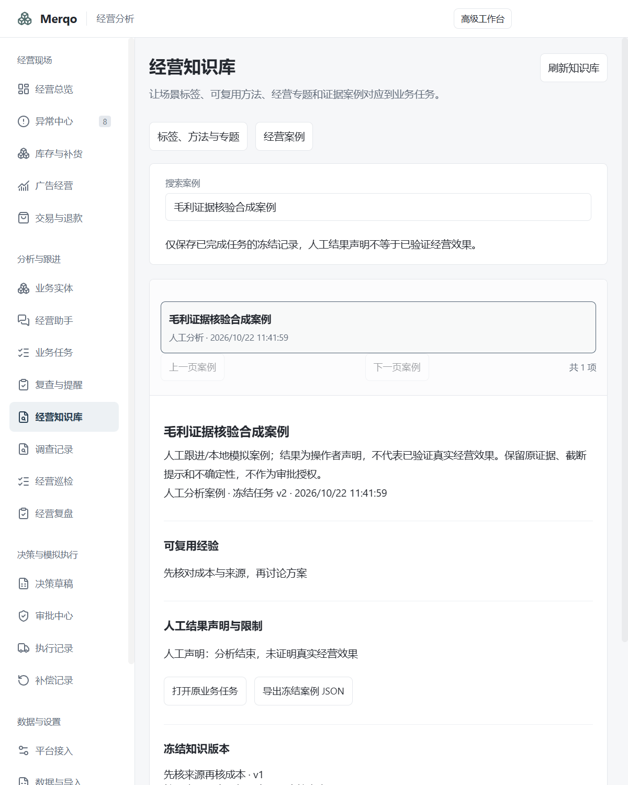

# 三批本地功能验收

2026-10-22，Windows 11本机，独立合成配置，不使用真实平台或用户数据。

最终完整领域回归：391项通过、0失败、3526条断言；Electron和领域TypeScript通过，main/renderer构建通过（保留既有大chunk提示）。并发复核测试单独复查通过，随后完整运行再次通过。

## 完整桌面链路

真实Electron、preload、IPC、Bun worker、SQLite与现有隔离模型适配器已贯通：

- 原调查创建任务，实体按明确来源/店铺/商品/规格及仓库或活动显示关联链路。
- 实体助手通过本机HTTP协议夹具完成一次真实适配器请求；无原生工具，回答引用属于冻结窗口。不是付费模型质量评测。
- 创建方法、标签、专题；方法v1绑定任务，升级v2后不改写任务和案例。
- 保存周期复查，生成待补证观察与本机提醒；确认提醒不完成任务。
- 明确开启巡检转任务，分批生成离线分析任务；重复触发不重复创建，不改源快照。
- 完成任务后冻结案例、观察和知识版本；原生下载得到相同案例JSON；同范围实体可再次检索经验。
- 三个新页面1440/800共六次内容加载后的横向溢出检查通过。实际关闭并重启，问答、任务、提醒确认、计划、知识版本与案例保存。

[桌面结果](desktop-result.json)，脚本：scripts/merqo-three-batches-check.cjs。原始trace与导出JSON：artifacts\three-batches\2026-10-22T03-40-59-714Z。

## 修复记录

验收修复知识/任务工具读取被误归为写请求而产生的并发拒绝，以及任务保存后清空详情导致归档表单重挂载、丢失输入。脚本还修正同名提醒复选框与区域的定位歧义。失败记录未计为通过。一次全量测试因长时间进程暂停导致旧并发测试超时，该项单独重跑通过；最终全量结果另行记录。

## 界面

## 安装与外部边界

beta.7安装验收结果将在完成后补充。真实平台授权、多用户可信身份、真实执行/因果收益、干净及跨版本Windows、签名信誉不在本机测试中伪装为完成。完整交付范围见[三批总表](../../three-batch-delivery-2026-10-22.md)。
